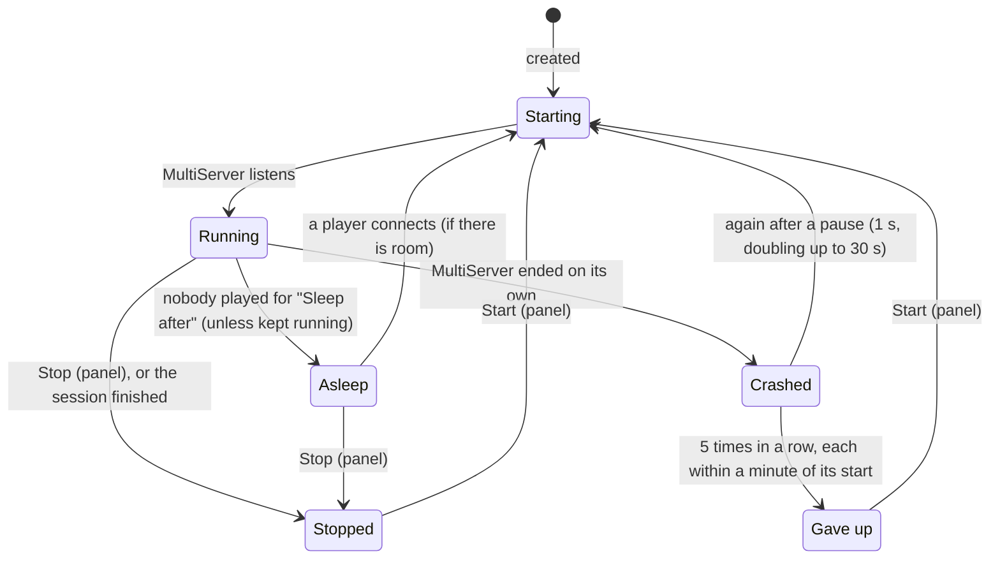

# Randogeddon: what it does

A compact reference of the rules, limits and settings. The README has the overview; the app explains its own buttons
(every option has an ⓘ).

## Sessions and their game servers

The gateway generates a session's seed itself (`Generate.py`, into `data/sessions/<id>/`), in the background: the
creation page can be closed. Once the seed is there, the tracker sets the session up and its game server starts.

- **Game servers at once** (*Users*, default 8; empty: no limit) counts starting, running and crashed ones (a few
  hundred MB each). **Sleep after** (*Users*, default 30 min; 0: never): a game server without players saves and
  stops; its first player wakes it (and waits). The tracker and hosted slots don't count as players. A server stopped
  by hand, given up or finished isn't woken that way. *Keep running without players*: an Administrator's switch.
- At the gateway's start (a deploy) none runs: every session sleeps until its first player.
- Generations at once: the cores less one (`GENERATIONS_AT_ONCE`); one longer than `GENERATION_MINUTES` (60) stops.
- Progress is saved continuously (`AP_<seed>.apsave`); `docker compose down` / `up -d` keeps it.

## Creating a session

In the Management panel (the gear button), *New session*; whoever creates it is its Session-Manager.

- **ID:** lowercase letters, digits and `-`, starting with a letter, no unwanted words; it's the game server's host
  name, so it can't change. A free one is suggested.
- **YAMLs:** one per slot with a unique `name:`; at most 100 files and 250 slots. A file that isn't a player YAML is
  refused with the reason; a game without its APWorld becomes a slot once the APWorld is there.
- **Who plays each slot:** one or more accounts (a slot played together); new players invited by e-mail right there
  (a link for 7 days; until they sign up they show as their suggested name or `Invited-…`, never their address).
  - *Open to all*: every player of the session (anyone named for any slot) plays it, on a card of its own,
    *Everyone*.
  - *Hosted*: a game with a server of its own that its players join. It starts open to all (they get its patch files
    and, hosted here, the bridge's tunnel; never its password); unticked, only the named players get it. Its
    Session-Managers get its whole connection. A hosted Minecraft Dig slot can have its server run here (an
    Administrator's tick, *its server here*).
  - Every slot is played by someone, hosted or open to all.
- **Locks:** per slot, *Random* (a number start open) or *Mixed* (per slot open, locked or chance); at least one slot
  starts open. See *Locked slots*.
- **Options:** hints and release mode; *Plando* (which kinds of a YAML's hand-made plans are used; the rest ignored);
  *Generation*: *No progression balancing*, *Race mode* (no spoiler log).
- **A seed generated elsewhere** (Administrators): the Launcher's `AP_<seed>.zip`, up to 64 MB. Checked before use
  (only a seed's files, one `.archipelago`, at most 1,000 files and 512 MB unpacked; its multidata read with
  Archipelago's restricted loader, no code runs); rewritten from what was read. No locks, no generation; its files
  for the players are the zip's, unchecked.

## A running session

- **Ending:** 2 minutes after every slot reached its goal or was released, with a countdown (*End now*, *Cancel*). A
  Session-Manager can *Pause* (not every check done) or *End* (100 %). The game server stops and stays stopped; the
  dashboard is read-only from then on.
- **Reopening:** within 14 days, unless it was completed, while a game server is free.
- **Finished sessions** keep their files and their last dashboard (`session_snapshots`); deleted by hand or
  `SESSION_RETENTION_DAYS` after the finish (90; 0: never), unless *Disable auto-deletion*.
- **Deleting** a running session moves its files to `data/old/`; a finished one's go for good. Accounts stay.
- **Slots** (*Edit slot:* in the panel; Session-Managers, Administrators): its players, *Open to all* and *Hosted*
  changed while it runs; late invites. Whoever loses a slot loses its connection: a new password, the gateway closes
  its connections; left without any slot, the open-to-all slots' too. An account timed out, suspended or deleted
  loses the slots only it played the same way. *Hosted* on asked once, off asked twice (a server hosted here stops).

## The spoiler log and the logic

- **In stages:** the seed comes with a spoiler log without its playthrough (level 1), so the session starts at once.
  The gateway then generates level 2 (the playthrough) and 3 (the paths) in the background from the kept inputs;
  a level replaces the one before only if it places every item the same. The spoiler page, hints and cheats wait for
  level 2. These runs share the generations' places, leave one free, and a level-3 run pauses for a new session.
  A playthrough Archipelago can't reduce lists every progression item in order instead (`spoiler_run.py`).
- **The spoiler page:** the playthrough sphere by sphere (checked steps marked) and the whole log, 300 lines at a
  time, searched on the server. Administrators, Session-Managers and support any time (behind a warning); players and
  watchers once it's finished.
- **The logic** counts each slot's available checks: the seed generated again up to the fill (`logic_run.py`), kept
  running from the game server's start until as long after it sleeps as the game servers wait (at least 10 min).
  It names the locations, too: a slot's panel lists them first. The last counts show while it doesn't run. Not for
  seeds from elsewhere, races, or a changed APWorld.

## The Management panel

- **A session:** its state and actions, *People* (parts: Session-Manager, support, watcher; the share link),
  *Slots*, *Patch files*, *Minecraft*, the logic, cheats, the game server (start, stop, restart), the console, and
  *Logs* as tabs (the game server's, the spoiler run's; the logic's and the Minecraft servers' for Administrators),
  each only for whoever may read it.
- **Cheats:** give an item, check a location (from the slot, or to it: another world's location holding its item),
  release, collect, free hints (only with *Cheat hints*; one place, a copy neither checked nor hinted). For a locked
  slot: *Unlock* (its key's location checked in its world; the lock says the server did) and *Hint its key's
  location*. Every cheat is logged with who did it and shown in the feed. Support has items, checks and hints, and
  sees the spoiler log's run (restarting it is the Session-Managers').
- **The console:** MultiServer's commands (`/players`, `/send <slot> <item>`, `/hint`, `/release`, `/collect`).
  `AP_ADMIN_PASSWORD` enables `!admin`.
- **Administrators** also get *Users*, *Archipelago* (APWorlds) and *Versions*.

## APWorlds

Per release, in `data/apworlds/<release>/`, uploaded in *Archipelago* (Administrators). An upload is checked (a zip with
one world folder, named after it, loaded by the release): one that doesn't load, or a game the release brings, is
refused. Replacing asks first. An APWorld of another release can be tried (*untested here*). Files in the server's
`custom_worlds/` count for every release.

## Hints and locked slots

- **Point hints:** *Points per check* (1), a hint costs *Hint cost* % of the slot's locations (10 %, 0: free).
  **Automatic hints:** games that hint by themselves. Both switched per session (`archipelago/serve.py`); with both off
  the dashboard hides hints.
- **Locked slots** (the World Locks APWorld): a key per locked slot is generated into the seed, so every seed stays
  completable. A locked slot can't connect (`SlotLocked`), has no password and no files until its key turns up;
  the gateway sees that within 10 s. Keys show as "Key to …".

## Logins and roles

- **Accounts** belong to people: invited by e-mail (7 days); a name of 3–32 characters (letters, digits, `_`; not
  reserved like *Admin* or *Hosted*; no unwanted words); a password of 12+ characters (Argon2id); an auto-deletion
  period. Logins last 30 days; logins are limited (5 sign-ups a minute per address, 10 wrong passwords or codes in
  10 minutes per account, the password change and the two-factor settings included); 10 mails in 10 minutes, 40 a
  day per account (a refused invitation or address change counts too).
- **Two-factor login** (TOTP, 10 recovery codes). Secrets encrypted with `TOTP_KEY`.
- **Administrators** come from Authentik (only a login through it acts as one). Without Authentik there are none,
  unless `ADMIN_PASSWORD_LOGIN` is set (local testing, the demo): then by password and two-factor.
- **Roles:** Administrator (everything), Session-Manager (their session; every user can create one, as many at once as
  *Sessions per user* allows, 0 to 20), support (items, checks, hints, the spoiler log), watcher (follows), player.
  A session keeps its last Session-Manager.
- **Keeping someone out:** time out (1 hour to 30 days) or suspend, with a reason; their logins end, their sessions go
  on. *Delete account* removes login, address and settings; sessions keep the name.
- **Slot passwords:** one per slot, generated with the seed; printable ASCII without spaces, quotes or backslashes. The
  gateway checks every `Connect` (`InvalidPassword`, `InvalidSlot`). Before its `Connect` a client gets 1 MiB frames,
  5 minutes and 32 frames; at most 1024 wait at once.
- **Share link** (`#/watch/<token>`): the dashboard read-only without a login, no passwords, no spoiler; at most 20
  live streams per address.

## Randogeddon Bridge

For game clients without TLS: the game connects to `localhost:<port>`, the bridge passes it on over `wss://` with
the slot's password. Logged in with a key (*Your connection*, 30 days), it offers the user's slots and, to
Session-Managers, the hosted ones; never a locked one. Command line: `login`, `slots`, `relay -session -slot
[-port]`, `logout`.

- **Minecraft Dig:** a slot hosted here gets a tunnel (`localhost:<port>` for Minecraft 1.19.4's *Direct
  Connection*) over `wss://<session>.<domain>/minecraft/<slot>` with the slot's tunnel key (made from its password;
  players get the key, never the password). The gateway answers the server list while the server sleeps, starts it
  for a join and holds the join until it's ready (~15 s to a minute), then passes every byte. The server connects to
  the session with the slot's password once a player is on it; it sleeps after the idle time (kept by the minecraft
  service), stops with its session's finish, by hand, when no longer hosted, or when its session is deleted. Nothing
  runs without `MINECRAFT_EULA=true`; `MINECRAFT_SERVERS` at once, each up to 3 GB.
- **Safe:** a key reaches only `/bridge/…`, checked every 15 s; relays listen on `127.0.0.1` only and refuse web pages
  (an `Origin` header); a tunnel ends anything that isn't a Minecraft handshake; the page answers only on its own
  address, with its link's token.
- **Checking a download:** `SHA256SUMS` signed with `bridge/signing-key.pub` (see the README).

## The dashboard

The tracker follows each running session as an Archipelago tracker client (one connection per slot) and keeps
everything it hears in the database: the gateway writes every event (`session_events`), the tracker replays them at
its start and keeps a snapshot of each dashboard (`session_snapshots`), so nothing is lost while it isn't connected.

- **Your connection:** server, slot and password as fields that can't be changed (the server copied as shown, host,
  port or `wss://`); the slot's patch files; the bridge (*Create key*, its downloads; folds away).
- **Overview:** tiles with pills (finished, slots, unlocked, hints, items, links, play time, session).
- **Players:** a card per player with their slots (state, time, pills for received, sent, available, deaths, traps;
  two bars: checks and progression checks), in as many columns as fit, each card into the shortest; *Sort* by name,
  progress or activity. A slot's states: released, complete, goal, locked, online, idle, not started.
- **Panels:** a player's (totals, slots, open hints, connections, activity) and a slot's, in tabs: *Checks* (available
  now, the rest remaining), *Map*, *Transported items* (sent, received), *Connections*; every list a page at a time.
- **The map:** generated from the logic for every game: its regions as boxes in columns from its start, linked as
  they connect; a big region's locations grouped by their names (`Area: Location`) into boxes of their own. Each
  location a dot: checked, open, available now; its name on hover (what it held once checked); filters by state.
  Only where the logic runs (as the available checks), kept with the slot while it sleeps.
- **Live feed** (filterable, 50 at a time) and **hints** (filterable); the feed beside the players or below.
- **Counts only:** progression counts per slot are its own world's; how many progression items are meant for a slot
  isn't shown (it would tell how much is missing).
- **Layout:** as wide as the window (2 % margins); the feed a quarter of it (440–640 dp).
- **Appearance:** themes (Randogeddon's, and inspired by Nintendo, PlayStation, Xbox and SteamOS consoles; no logos)
  in light, dark or automatic, each with its own font (all under the SIL OFL or Apache 2.0, `/fonts/licences/`).
  Stored with the account. **Languages:** English and German, stored with the account.
- **Install:** a PWA (*Install app* / *Add to Home Screen*); needs WebAssembly GC (Safari 18.2+, Chrome 119+,
  Firefox 120+). The login form is plain HTML, so password managers fill it.
- **Limitations:** each tracker connection posts "X tracking … has joined"; the feed shows the last 500 events.

## Names nobody should have

Names and session IDs are checked against about 9,600 swear words and slurs in 17 languages (`unwanted-words.txt`,
made by `scripts/unwanted_words.py` from LDNOOBW, BadWords and Google Profanity Words, cleaned with FrequencyWords and
first names), part by part, written together and with digits as letters; long words also inside others. It keeps the
obvious out; whoever is refused isn't told which word.
