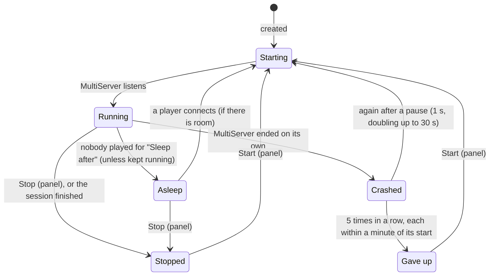

# Randogeddon: what it does

A compact reference of the rules, limits and settings. The README has the overview; the app explains its own buttons
(every option has an ⓘ).

## Sessions and their game servers

The gateway generates a session's seed itself (`Generate.py`, into `data/sessions/<id>/`), in the background: the
creation page can be closed. Once the seed is there, the tracker sets the session up and its game server starts.

- **Game servers at once** (*Users*, default 8; empty: no limit) counts starting, running and crashed ones (a few
  hundred MB each). **Sleep after** (*Users*, default 30 min; 0: never): a game server without players saves and
  stops; its first player wakes it (and waits): a `Connect` with a slot's right password, nothing else. The tracker and hosted slots don't count as players. A server stopped
  by hand, given up or finished isn't woken that way. *Keep running without players*: an Administrator's switch.
- At the gateway's start (a deploy) none runs: every session sleeps until its first player.
- Generations at once: the cores less one (`GENERATIONS_AT_ONCE`); one longer than `GENERATION_MINUTES` (60) stops.
- Progress is saved continuously (`AP_<seed>.apsave`); `docker compose down` / `up -d` keeps it.

## Creating a session

In the Management panel (the gear button), *New session*; whoever creates it is its Session-Manager.

- **ID:** lowercase letters, digits and `-`, starting with a letter, no unwanted words; it's the game server's host
  name, so it can't change. A free one is suggested.
- **YAMLs:** one per slot with a unique `name:`; at most 100 files and 250 slots. A file that isn't a player YAML is
  refused with the reason; a game without its APWorld becomes a slot once the APWorld is there.
- **Who plays each slot:** one or more accounts (a slot played together); new players invited by e-mail right there
  (a link for 7 days; until they sign up they show as their suggested name or `Invited-…`, never their address).
  - *Open to all*: every player of the session (anyone named for any slot) plays it, on a card of its own,
    *Everyone*.
  - *Hosted*: a game with a server of its own that its players join. It starts open to all (they get its patch files
    and, hosted here, the bridge's tunnel; never its password); unticked, only the named players get it. Its
    Session-Managers get its whole connection. A hosted Minecraft Dig slot can have its server run here (an
    Administrator's tick, *its server here*).
  - Every slot is played by someone, hosted or open to all.
- **Locks:** per slot, *Random* (a number start open) or *Mixed* (per slot open, locked or chance); at least one slot
  starts open. See *Locked slots*.
- **Options:** hints and release mode; *Plando* (which kinds of a YAML's hand-made plans are used; the rest ignored);
  *Generation*: *No progression balancing*, *Race mode* (no spoiler log).
- **A seed generated elsewhere** (Administrators): the Launcher's `AP_<seed>.zip`, up to 64 MB. Checked before use
  (only a seed's files, one `.archipelago`, at most 1,000 files and 512 MB unpacked; its multidata read with
  Archipelago's restricted loader, no code runs); rewritten from what was read. No locks, no generation; its files
  for the players are the zip's, unchecked.

## A running session

- **Ending:** 2 minutes after every slot reached its goal or was released, with a countdown (*End now*, *Cancel*). A
  Session-Manager can *Pause* (not every check done) or *End* (100 %). The game server stops and stays stopped; the
  dashboard is read-only from then on.
- **Reopening:** within 14 days, unless it was completed, while a game server is free.
- **Finished sessions** keep their files and their last dashboard (`session_snapshots`); deleted by hand or
  `SESSION_RETENTION_DAYS` after the finish (90; 0: never), unless *Disable auto-deletion*.
- **Deleting** a running session moves its files to `data/old/`; a finished one's go for good. Accounts stay.
- **Slots** (*Edit slot:* in the panel; Session-Managers, Administrators): its players, *Open to all* and *Hosted*
  changed while it runs; late invites. Whoever loses a slot loses its connection: a new password, the gateway closes
  its connections; left without any slot, the open-to-all slots' too. An account timed out, suspended or deleted
  loses the slots only it played the same way. *Hosted* on asked once, off asked twice (a server hosted here stops).

## The spoiler log and the logic

- **In stages:** the seed comes with a spoiler log without its playthrough (level 1), so the session starts at once.
  The gateway then generates level 2 (the playthrough) and 3 (the paths) in the background from the kept inputs;
  a level replaces the one before only if it places every item the same. Nothing waits for them but a hint's *next
  in playthrough* (offered from level 2 on; until then a hint names a copy by chance). These runs share the
  generations' places, leave one free, and a level-3 run pauses for a new session.
  A playthrough Archipelago can't reduce lists every progression item in order instead (`spoiler_run.py`).
- **The spoiler page:** from the seed on what it was made with (its settings, each slot's options, what the games
  noted) and where every item lies (a row a location, checked ones marked; by slot, searched, a page at a time); by
  tabs of their own once worked out: the playthrough sphere by sphere (checked steps marked, 100 of a sphere at a
  time), and the paths (a location's regions from the start); and the log as text, 300 lines at a time, searched on
  the server. Administrators, Session-Managers and support any time, a running session's behind a warning (on the
  panels' buttons and on the page itself, asked once a browser tab); players and watchers once it's finished.
- **The logic** counts each slot's available checks: the seed generated again up to the fill (`logic_run.py`), kept
  running from the game server's start until as long after it sleeps as the game servers wait (at least 10 min).
  It names the locations, too: a slot's panel lists them first. The last counts show while it doesn't run. Not for
  seeds from elsewhere, races, or a changed APWorld. Available means reachable by the game's rules with what the
  slot has: its items as the seed classed them, its starting items, and the World Keys found (an opened world has
  its real counts and map). At its build the logic replays the seed's own order against the rebuilt rules: a slot
  whose rebuild doesn't fit keeps its numbers and map, under a warning nobody overlooks (its pill framed, a banner
  above its checks and its map, its reason in the panel's logic section). The reason is for Session-Managers,
  Support and Administrators: everyone else, share links too, sees the warning without it (it may name a location).

## The Management panel

- **A session:** its state and actions, *People* (parts: Session-Manager, support, watcher; the share link),
  *Slots*, *Patch files*, *Minecraft*, the logic, cheats, the game server (start, stop, restart), the console, and
  *Logs* as tabs (the game server's, the spoiler run's; the logic's and the Minecraft servers' for Administrators),
  each only for whoever may read it.
- **Cheats:** give an item, check a location (from the slot, or to it: another world's location holding its item),
  release, collect, free hints (only with *Cheat hints*; one place, a copy neither checked nor hinted). For a locked
  slot: *Unlock* (its key's location checked in its world; the lock says the server did) and *Hint its key's
  location*. Every cheat is logged with who did it and shown in the feed. Support has items, checks and hints, and
  sees the spoiler log's run (restarting it is the Session-Managers').
- **The console:** MultiServer's commands (`/players`, `/send <slot> <item>`, `/hint`, `/release`, `/collect`); a
  line that would set a password isn't passed on. There is no `!admin` from a game client.
- **Administrators** also get *Users*, *Archipelago* (APWorlds) and *Versions*.

## APWorlds

Per release, in `data/apworlds/<release>/`, uploaded in *Archipelago* (Administrators). An upload is checked (a zip with
one world folder, named after it, loaded by the release): one that doesn't load, or a game the release brings, is
refused. Replacing asks first. An APWorld of another release can be tried (*untested here*). Files in the server's
`custom_worlds/` count for every release.

## Hints and locked slots

- **Point hints:** *Points per check* (1), a hint costs *Hint cost* % of the slot's locations (10 %, 0: free).
  **Automatic hints:** games that hint by themselves. Both switched per session (`archipelago/serve.py`); with both off
  the dashboard hides hints.
- **Locked slots** (the World Locks APWorld): a key per locked slot is generated into the seed, so every seed stays
  completable. A locked slot can't connect (`SlotLocked`), has no password and no files until its key turns up;
  the gateway sees that within 10 s. Keys show as "Key to …".

## Logins and roles

- **Accounts** belong to people: invited by e-mail (7 days); a name of 3–32 characters (letters, digits, `_`; not
  reserved like *Admin* or *Hosted*; no unwanted words); a password of 12+ characters (Argon2id) that isn't
  obvious (below); an auto-deletion period. Every password field has an eye that shows what was typed. Logins last 30 days; logins are limited (5 sign-ups a minute per address, 10 wrong passwords or codes in
  10 minutes per account, the password change and the two-factor settings included); 10 mails in 10 minutes, 40 a
  day per account (a refused invitation or address change counts too).
- **A new password** (at the sign-up, the settings' change, a reset) needs its length, 12 to 256 characters, and no
  kinds of characters. Refused, whatever its case: the account's name or the part of its address before the `@`
  inside it (from 4 characters on); one character or a pattern of up to 4 repeated throughout; a run along the
  digits, the alphabet or a keyboard's rows (QWERTY, QWERTZ), either way; one common word (a list of 111, with the
  usual letter swaps undone) with only digits, symbols or itself around it. A phrase of several words passes, also
  with a common word among them. Existing passwords are not looked at.
- **A forgotten password** (the login page, where a mail server is set): the name or address is typed, the
  account's address is shown partly hidden (`m•••@p•••.me`) and has to be typed in full; only then a mail goes
  there, with a link that works 15 minutes and once (3 mails an account an hour, 10 tries a network address). The
  link's page sets the new password; every login of the account ends (bridge keys too, and one waiting for its
  two-factor code), a second mail tells of the change, and two-factor login stays. Nothing tells whether an account exists: an unknown name gets a made-up
  hidden address (the same each time), and the answer after the address is always the same. Not for accounts that
  log in through single sign-on only, kept-out ones, or invitations not yet taken.
- **Two-factor login** (TOTP, 10 recovery codes). Secrets encrypted with `TOTP_KEY`.
- **Administrators** come from Authentik (only a login through it acts as one). Without Authentik there are none,
  unless `ADMIN_PASSWORD_LOGIN` is set (local testing, the demo): then by password and two-factor.
- **Roles:** Administrator (everything), Session-Manager (their session; every user can create one, as many at once as
  *Sessions per user* allows, 0 to 20), support (items, checks, hints, the spoiler log), watcher (follows), player.
  A session keeps its last Session-Manager.
- **Keeping someone out:** time out (1 hour to 30 days) or suspend, with a reason; their logins end, their sessions go
  on. *Delete account* removes login, address and settings; sessions keep the name.
- **Slot passwords:** one per slot, generated with the seed; printable ASCII without spaces, quotes or backslashes. The
  gateway checks every `Connect` (`InvalidPassword`, `InvalidSlot`). Before its `Connect` a client gets 1 MiB frames,
  5 minutes, 32 frames and 32 packets (only `Connect` and `GetDataPackage` are passed on); at most 1024 wait at
  once (32 per address), a sleeping game server's wake included. Each game server has a room password of its own
  that the gateway puts in a checked slot password's place: past the gateway nobody joins.
- **Share link** (`#/watch/<token>`): the dashboard read-only without a login, no passwords, no spoiler; as many
  live streams per address as the Administrators set (*Users*, default 20; empty: no limit).

## Randogeddon Bridge

A web page that connects as a client (a tracker built on archipelago.js) takes the session's host name without a
port: it then uses 38281, where the server answers with TLS too (`.docs/OPERATIONS.md`). The bridge is not for
web pages.

For game clients without TLS: the game connects to `localhost:<port>`, the bridge passes it on over `wss://` with
the slot's password. Logged in with a key (*Your connection*, 30 days), it offers the user's slots and, to
Session-Managers, the hosted ones; never a locked one. Command line: `login`, `slots`, `relay -session -slot
[-port]`, `logout`.

- **Minecraft Dig:** a slot hosted here gets a tunnel (`localhost:<port>` for Minecraft 1.19.4's *Direct
  Connection*) over `wss://<session>.<domain>/minecraft/<slot>` with the slot's tunnel key (made from its password;
  players get the key, never the password). The gateway answers the server list while the server sleeps, starts it
  for a join and holds the join until it's ready (~15 s to a minute), then passes every byte. The server connects to
  the session with the slot's password once a player is on it; it sleeps after the idle time (kept by the minecraft
  service), stops with its session's finish, by hand, when no longer hosted, or when its session is deleted. Nothing
  runs without `MINECRAFT_EULA=true` and `MINECRAFT_TOKEN`; `MINECRAFT_SERVERS` at once, each up to 3 GB.
- **Safe:** a key reaches only `/bridge/…`, checked every 15 s with one call (an outage doesn't log out: only the
  dashboard's own "key gone" does), and goes only to the dashboard it was made for (another `-server` is logged out
  for that run); nothing goes out unencrypted but to this computer (`https://`, `wss://`; no redirect followed).
  Relays listen on `127.0.0.1` only, refuse web pages (an `Origin` header) and carry 32 games at most; closing one,
  logging out or an ended key ends its games. A tunnel ends anything that isn't a Minecraft handshake. The page
  answers only on its own address, with its token (no cookie: its link works once, for five minutes; a second start
  gives a new one). At most ten keys an account.
- **Its page:** sessions by their titles (every running one the user plays in or manages, also with only open or
  hosted slots). Closing the page closes the bridge, unless a game is connected: then it quits when the last one
  left (the page says so).
- **Checking a download:** `SHA256SUMS` signed with `bridge/signing-key.pub`; the key's fingerprint is shown under
  *Your connection* (from the web app's own build) and in the README, to check the key by before the signature; the
  bridge's update notice says so. A release isn't published unless its builds are signed with that key.

## The dashboard

The tracker follows each running session as an Archipelago tracker client (one connection per slot) and keeps
everything it hears in the database: the gateway writes every event (`session_events`), the tracker replays them at
its start and keeps a snapshot of each dashboard (`session_snapshots`), so nothing is lost while it isn't connected.

- **By keyboard:** Tab goes through every control, the focused one in a ring; Enter and Space press it, Enter sends
  the form or search it is typed into, the arrow keys move sliders and numbers. A text selection stays in the panel
  it was begun in. The file pickers remember a folder for each kind of file (YAMLs, seeds, APWorlds; in browsers
  that can) and say when a file is too large or can't be read.
- **Its frame:** an open page goes on by itself after the tracker restarted or was away (asking again after 2 s, then
  less often, up to 30 s). Someone with one session is always in it, without a session switch. Logging out says so
  if it didn't reach the server. A login or invitation link is taken out of the address bar once it was used. What
  a player wrote (chat, an alias) arrives as one line without characters that could fake another's.

- **Your connection:** server, slot and password as fields that can't be changed (the server copied as shown, host,
  port or `wss://`); the slot's patch files; the bridge (*Create key*, its downloads; folds away).
- **Overview:** tiles with pills (finished, slots, unlocked, hints, items, links, play time, session).
- **Players:** a card per player with their slots (state, time, pills for received, sent, available, deaths, traps;
  two bars: checks and progression checks), in as many columns as fit, each card into the shortest; *Sort* by name,
  progress or activity. A slot's states: released, complete, goal, locked, online, idle, not started.
- **Panels:** a player's (totals, slots, open hints, connections, activity) and a slot's, in tabs: *Checks* (available
  now, the rest remaining), *Map*, *Transported items* (sent, received), *Connections*; every list a page at a time.
- **The map:** generated from the logic for every game: its regions as boxes, a tree from its start (one line from a
  box branching off to the boxes first reached from it, no line crossing a box or another; its other connections on
  hover), scrolled both ways by its bars or by dragging, sized up over the window and to full screen by its button; a
  big region's locations grouped by their names (`Area: Location`) into boxes of their own. Each location a dot:
  checked, open, available now; its name on hover (what it held once checked); filters by state. A region the
  slot's logic can't reach now (one that opens with an item still to come) is marked: a lock, a dashed edge, a
  dashed line into it; not by whom or what. Only where the logic runs (as the available checks), kept with the slot
  while it sleeps.
- **Live feed** (filterable, 50 at a time) and **hints** (filterable); the feed beside the players or below, or
  pinned: a window over the page on every view (moved, folded; its place remembered in the browser).
- **Counts only:** progression counts per slot are its own world's; how many progression items are meant for a slot
  isn't shown (it would tell how much is missing).
- **Layout:** as wide as the window (2 % margins); the feed a quarter of it (440–640 dp).
- **Appearance:** themes (Randogeddon's, and inspired by Nintendo, PlayStation, Xbox and SteamOS consoles; no logos)
  in light, dark or automatic, each with its own font (all under the SIL OFL or Apache 2.0, `/fonts/licences/`).
  Stored with the account. **Languages:** English and German, stored with the account.
- **Install:** a PWA (*Install app* / *Add to Home Screen*); needs WebAssembly GC (Safari 18.2+, Chrome 119+,
  Firefox 120+). The login form is plain HTML, so password managers fill it.
- **Limitations:** each tracker connection posts "X tracking … has joined"; the feed shows the last 500 events.

## Names nobody should have

Names and session IDs are checked against about 9,600 swear words and slurs in 17 languages (`unwanted-words.txt`,
made by `scripts/unwanted_words.py` from LDNOOBW, BadWords and Google Profanity Words, cleaned with FrequencyWords and
first names), part by part, written together and with digits as letters; long words also inside others. It keeps the
obvious out; whoever is refused isn't told which word.
