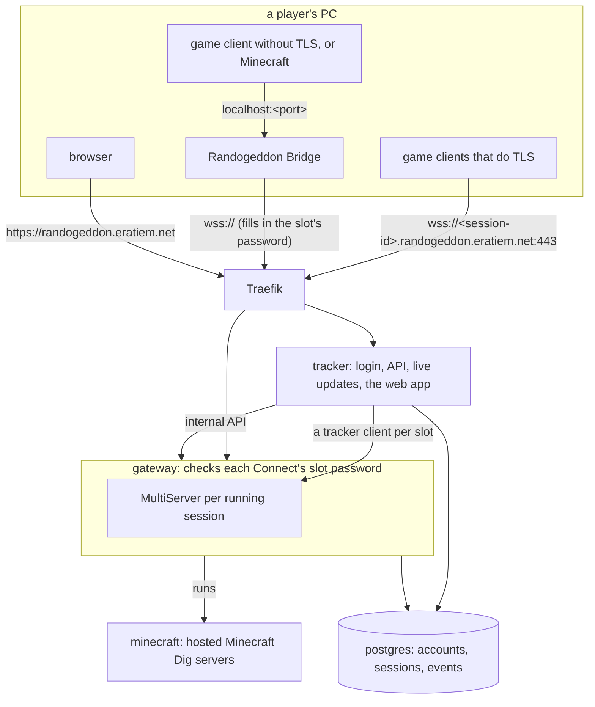

# Randogeddon

Our self-hosted [Archipelago](https://archipelago.gg) multiworld server (plain `MultiServer`, AP **0.6.8**) with a live
dashboard. Several sessions run at once, each with its own game server at `<session-id>.randogeddon.eratiem.net:443`
and a generated password per slot. Every user creates sessions and manages them in the dashboard's panel; support
helps the players, watchers follow along. Everything runs in Docker behind Traefik; the dashboard is at
`randogeddon.eratiem.net` and needs a login.

A **player** is a person with a login; a **slot** is one YAML, one game of the multiworld, played by one or more
players (Archipelago says "player" for a slot, e.g. in `/send <player>`).

The details: [what it does](.docs/FEATURES.md), [running the server](.docs/OPERATIONS.md),
[development](.docs/DEVELOPMENT.md). What's done and what comes next: [.docs/TODO.md](.docs/TODO.md); every version:
[CHANGELOG.md](CHANGELOG.md).



| Part | What it is |
|---|---|
| `server/` | The tracker (Kotlin, Ktor, native image): logins, the API, the dashboard's live data, the host commands (`randogeddon …`) |
| `gateway/` | The game host: generates seeds, runs one MultiServer per running session (asleep without players), relays each game client and checks its slot password |
| `webApp/` | The dashboard (Compose Multiplatform, Kotlin/Wasm), installable as an app |
| `bridge/` | Randogeddon Bridge (Go): for game clients without TLS, and the tunnel to a hosted Minecraft server |
| `database/`, `shared/` | The PostgreSQL schema (Flyway) and the API's types, shared by the others |
| `archipelago/`, `apworlds/` | Archipelago's wrappers (hint switches, spoiler and logic runs, the Minecraft host) and our World Locks APWorld |
| `demo/`, `scripts/` | Example sessions with simulated players; deploying, the demo, measuring, the audit |

## A session

1. **Create it** in the *Management panel* (the gear button): a session ID, the slots' YAMLs (or, for Administrators,
   a seed generated elsewhere), who plays each slot (or *Open to all*, or *Hosted* for a game with a server of its
   own), the locks, the hint and release options. It generates in the background; whoever creates it is its
   Session-Manager.
2. **Players are invited** by e-mail from the form, or picked from the accounts; they choose their name and password.
3. **Players log in** at `https://randogeddon.eratiem.net`. *Your connection* has the server, their slots with the
   passwords and the patch files; the dashboard shows the progress, the players, hints and the live feed.
4. **The game server** starts when the session is made, sleeps when nobody plays and wakes with the first player.
   The session ends by itself once every slot is done; its Session-Managers can pause, end, reopen or delete it.

Locked slots open when their key is found in another world; hints cost points or come from the games themselves; the
spoiler log, the available checks and the cheats are in the panel. All of it: [what it does](.docs/FEATURES.md).

| Role | What they do |
|---|---|
| Administrator | Everything: every session, the users, the APWorlds, the settings (through Authentik, or `randogeddon admins`) |
| Session-Manager | Their session: its game server and console, its people, its slots, cheats and spoiler log |
| Support | Helps a session's players: items, locations, free hints, its spoiler log |
| Player | Plays their slots; adds watchers and shares a read-only link |
| Watcher | Follows a session: dashboard, feed, hints |

## The server

```sh
git clone <this repo> /srv/randogeddon && cd /srv/randogeddon
cp .env.example .env     # the passwords, the domain, Traefik's names; see the comments in it
docker compose build     # needs BuildKit and about 8 GB of RAM for the native images
docker compose up -d
docker compose exec tracker randogeddon admins --create <person>   # without single sign-on: the first Administrator
```

DNS needs `randogeddon.eratiem.net` and `*.randogeddon.eratiem.net`; Traefik routes both, with a wildcard certificate
(DNS challenge). The settings that matter most in `.env`:

| Setting | What it is |
|---|---|
| `POSTGRES_PASSWORD`, `INTERNAL_TOKEN` | The database's superuser, and the token between tracker and gateway |
| `TRACKER_DB_*`, `GATEWAY_DB_*` | Database logins of their own for tracker and gateway (recommended) |
| `BASE_DOMAIN`, `TRAEFIK_*` | The public domain and Traefik's network, entrypoint and cert resolvers |
| `OIDC_*` | Administrators through Authentik (single sign-on) |
| `MAIL_*`, `TOTP_KEY` | The mail server for invitations, and the key of the two-factor secrets |
| `AP_VERSION`, `AP_COMMIT` | The Archipelago release the gateway image brings |
| `MINECRAFT_EULA` | `true`: the operator accepts Mojang's EULA, so hosted Minecraft Dig servers can run |

A release is deployed from its signed tag with `scripts/deploy.sh` (build, push, dump, switch, check;
`--rollback` goes back). The game servers save continuously; `docker compose down` and `up -d` keep the progress.
Traefik, Authentik, the database logins, mail, the live server, backups and updating Archipelago:
[running the server](.docs/OPERATIONS.md).

## Randogeddon Bridge

For a game whose client can't do TLS, and for a hosted Minecraft Dig server: the bridge runs on the player's PC, the
game connects to `localhost:<port>`, and the bridge takes it to the session over `wss://` with the slot's password
(the game's name and password don't matter). Download it under *Your connection* (Windows, Linux, macOS), create a key
there and paste it into the bridge's page; a key is a login for 30 days. It listens on `127.0.0.1` only and belongs on
a computer that is yours alone.

The builds aren't signed by a bought certificate, so the systems warn. Check a download against Randogeddon's key
(`bridge/signing-key.pub`, `SHA256:Y/hZRRTeTgoizXJ9CVzWCpIcr3RISfCy+STg3hp+v6w`), in the folder with *Checksums* and
*Signature* from beside the downloads:

```sh
ssh-keygen -Y verify -f signing-key.pub -I bridge@randogeddon -n randogeddon-bridge -s SHA256SUMS.sig < SHA256SUMS
sha256sum --ignore-missing -c SHA256SUMS     # macOS: shasum -a 256 --ignore-missing -c SHA256SUMS
```

The command line, the Minecraft tunnel and how it stays safe: [the bridge](.docs/FEATURES.md#randogeddon-bridge).

## Development

```sh
./scripts/demo.sh                                    # the stack locally, two sessions played by simulated players
./gradlew :server:test :gateway:test :database:test  # unit tests (also run in the Docker build)
./gradlew :webApp:wasmJsBrowserDistribution          # the web app
cd bridge && go test -race ./...                     # the bridge
```

Gradle 9.8.2, Kotlin 2.4, JDK 25; the native images (GraalVM 25) build on Linux, on Windows in WSL. A version is
`0.<phase>.<step>`: a PR's branch builds `-SNAPSHOT`, its merge is the release and gets the tag `v<version>`. Every text
is typed Kotlin in English and German (`shared/…/i18n/`). A new migration goes into `index.txt` beside it. Local
testing, the native build, measuring, the audit and the API: [development](.docs/DEVELOPMENT.md).

## Built with

Randogeddon stands on these, each under its own license:

| Where | What |
|---|---|
| Games | [Archipelago](https://github.com/ArchipelagoMW/Archipelago) (`MultiServer`, `Generate.py`, its worlds); for Minecraft Dig [Minecraft Forge](https://minecraftforge.net) and the [Minecraft AP Randomizer](https://github.com/jacobmix/Minecraft_AP_Randomizer) mod, on [Eclipse Temurin](https://adoptium.net) 17 |
| Tracker and gateway | [Kotlin](https://kotlinlang.org), [Ktor](https://ktor.io), [kotlinx.coroutines](https://github.com/Kotlin/kotlinx.coroutines) and [kotlinx.serialization](https://github.com/Kotlin/kotlinx.serialization), [kaml](https://github.com/charleskorn/kaml), [Koin](https://insert-koin.io), [Exposed](https://github.com/JetBrains/Exposed), [Flyway](https://github.com/flyway/flyway), [HikariCP](https://github.com/brettwooldridge/HikariCP), the [PostgreSQL JDBC driver](https://jdbc.postgresql.org), [Bouncy Castle](https://www.bouncycastle.org) (Argon2id), [SLF4J](https://www.slf4j.org) and [Logback](https://logback.qos.ch); native images with [GraalVM](https://www.graalvm.org) Community |
| Dashboard | [Compose Multiplatform](https://www.jetbrains.com/compose-multiplatform/) on Kotlin/Wasm, [kotlinx-browser](https://github.com/Kotlin/kotlinx-browser), [QR Code generator](https://github.com/nayuki/QR-Code-generator) (the two-factor setup); its fonts from [Google Fonts](https://fonts.google.com) and others (SIL OFL 1.1, Roboto Slab Apache 2.0; each licence in `webApp/…/fonts/licences/`) |
| Randogeddon Bridge | [Go](https://go.dev), [coder/websocket](https://github.com/coder/websocket), [x/term](https://pkg.go.dev/golang.org/x/term) |
| Running | [Docker](https://www.docker.com) and Compose, [PostgreSQL](https://www.postgresql.org), [Python](https://www.python.org), [Traefik](https://traefik.io) in front, optionally [Authentik](https://goauthentik.io) for the Administrators' single sign-on; Artifact Keeper as the registry |
| Building and checking | [Gradle](https://gradle.org), [Binaryen](https://github.com/WebAssembly/binaryen) (by Kotlin/Wasm), [Brotli](https://github.com/google/brotli), [Testcontainers](https://testcontainers.com), [osv-scanner](https://github.com/google/osv-scanner) (the dependencies' known flaws), [hadolint](https://github.com/hadolint/hadolint), [Playwright](https://playwright.dev) (the first screen's timing), [Mailpit](https://github.com/axllent/mailpit) (mails in the local stack), [Mermaid](https://mermaid.js.org) (the diagrams) |
| Unwanted names | the word lists [LDNOOBW](https://github.com/LDNOOBW/List-of-Dirty-Naughty-Obscene-and-Otherwise-Bad-Words) (CC BY 4.0), [BadWords](https://github.com/FlacSy/badwords) (MIT), [Google Profanity Words](https://github.com/coffee-and-fun/google-profanity-words) (MIT), cleaned with [FrequencyWords](https://github.com/hermitdave/FrequencyWords) |

## License

Randogeddon is released under the [EraTiem-Network Non-Commercial License 1.0](LICENSE): free to use and to pass on
unchanged for non-commercial purposes; no modified copies, no paid use without a separate license
(info@eratiem.net). Archipelago and the libraries Randogeddon uses keep their own licenses.
