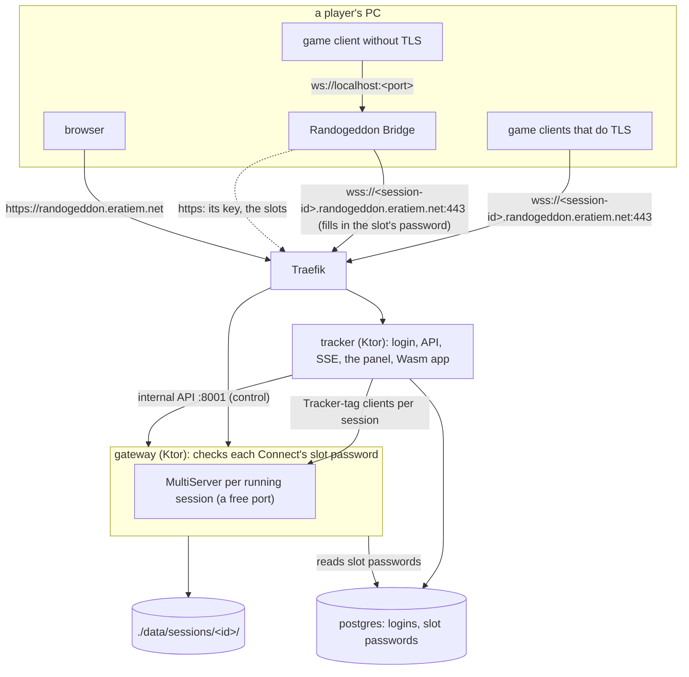
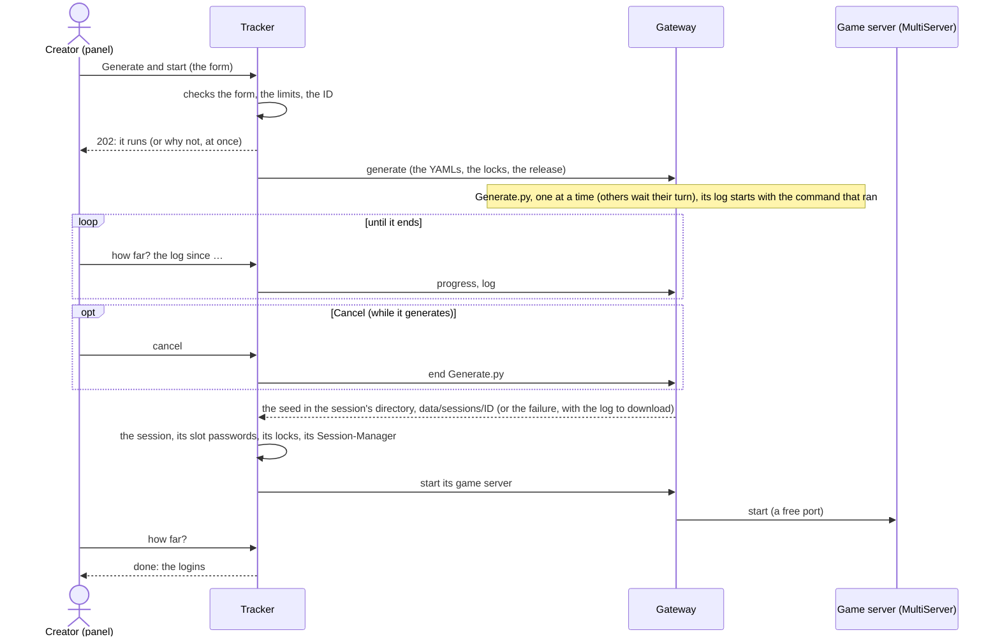
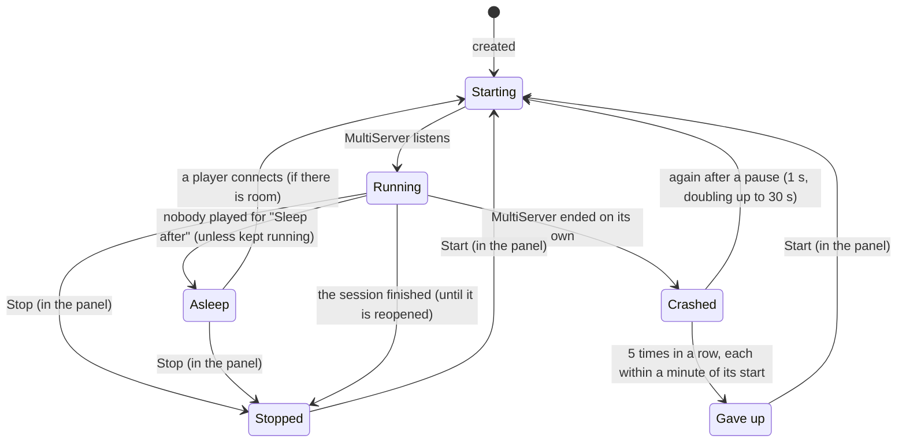

# Randogeddon

Our self-hosted [Archipelago](https://archipelago.gg) multiworld server (plain `MultiServer`, AP **0.6.8**)
plus a custom live dashboard. Everything runs in Docker behind an existing Traefik. The dashboard is at
`randogeddon.eratiem.net` and needs a login. Several sessions can run at once, each with its own game server at
`<session-id>.randogeddon.eratiem.net:443`, where every slot has its own generated password. The gateway runs the game
servers; every user creates sessions and, as their Session-Manager, starts, stops and commands their game servers from
the panel; support helps the players, watchers follow along. The Kotlin apps (tracker and gateway) run as native
executables (GraalVM Native Image, Linux x86_64).

What's done and what comes next (login, the panel, multiple sessions, user management, roles): [.docs/TODO.md](.docs/TODO.md).

Words used here and in the dashboard: a **player** is a person (with a login); a **slot** is one YAML, one game in
the multiworld, played by one or more players (Archipelago itself says "player" for a slot, e.g. in `/send <player>`);
the **game** is just its title, e.g. Hollow Knight.



The gateway runs one MultiServer per running session as a child process, each on a free port of its container. Only
the tracker reaches them directly (those ports and the internal API on 8001 are not published). How many run at once
is a setting of the Administrators (*Game servers at once*, under *Users*; default 8, empty: no limit): each one needs
a few hundred MB of the gateway's memory. One nobody plays on for a while sleeps (*Sleep after*, under *Users*;
default 30 minutes) and starts again when a player connects. The gateway relays each game client to its session's MultiServer: by the host name it
connected to (`<session-id>.<BASE_DOMAIN>`), or locally by the path (`ws://localhost:38281/<session-id>`). A tracker
restart or update doesn't drop the players.

### Sessions and their game servers

A new session's seed isn't made by a game server: the gateway runs Archipelago's `Generate.py` itself, one generation
at a time, and puts the seed into `data/sessions/<id>/`. The tracker runs the creation in the background, so the page
can be closed meanwhile; only once the seed is there and the session is set up does its game server start.



Each session has its game server: one MultiServer, run only while it is needed. One nobody plays on sleeps, and the
first player who connects starts it again (if fewer run than may at once; they wait a moment meanwhile).



- **At the gateway's start** (a deploy, a reboot) none starts: every session sleeps until its first player, a
  finished one stays stopped.
- **Game servers at once** (*Users*, default 8) counts *Starting*, *Running* and *Crashed*: those hold a MultiServer
  (a few hundred MB each). Asleep, stopped, given up and finished sessions don't; with all of them asleep the gateway
  itself needs some 35 MB.
- A player can't wake one that was stopped by hand, gave up or is finished; the panel can start it.
- *Keep running without players* (an Administrator's switch in a session's *State and Control*) keeps it from
  sleeping; *Sleep after* `0` keeps them all running.

| Path | What it is |
|---|---|
| `archipelago/` | `serve.py` (MultiServer with the hint switches), `room_info.py`, `list_games.py`; the gateway image installs Archipelago next to them |
| `server/` | Tracker server: Kotlin + Ktor. Follows every session's room, serves the login, the API and the web app; host commands (`randogeddon admins`) |
| `gateway/` | The game host: runs one MultiServer per session, relays each client connection to its session's and checks the slot password of every `Connect`; internal API for the panel |
| `database/` | PostgreSQL schema (Flyway migrations) and Exposed tables, shared by tracker and gateway |
| `webApp/` | The dashboard: Compose Multiplatform (Kotlin/Wasm), installable as a PWA |
| `bridge/` | Randogeddon Bridge (Go): takes game clients that can't do TLS from `localhost` to their session, see *Randogeddon Bridge* |
| `shared/` | The API contract (Kotlin Multiplatform data classes) used by both |
| `apworlds/world_locks/` | Our own APWorld: slots that start locked until their key is found (part of the gateway image) |
| `demo/` | Two example sessions (YAMLs and who plays which slot, in `a/` and `b/`), simulated players — see *Demo* below |
| `kotlin.Dockerfile` | Builds the tracker image and the gateway image (native, plus the pinned Archipelago release) |
| `custom_worlds/` | Extra `.apworld` files for games that aren't bundled, for every release (gitignored); or upload them in the panel (Administrators) |
| `output/` | The demo's files (gitignored) |
| `data/` | Server side: each session's seed, `.apsave` savegame and `room.json` in `sessions/<id>/`, deleted ones in `old/`, the uploaded APWorlds in `apworlds/<release>/` (gitignored) |
| `scripts/demo.sh` | The demo |
| `scripts/unwanted_words.py` | Makes the list of words no name and no session ID may contain (`server/src/main/resources/unwanted-words.txt`) |

## One-time server setup

```sh
git clone <this repo> /srv/randogeddon && cd /srv/randogeddon
cp .env.example .env     # set POSTGRES_PASSWORD, INTERNAL_TOKEN, TRACKER_DB_*, GATEWAY_DB_*, BASE_DOMAIN, TRAEFIK_* …
docker compose build     # takes a few minutes (every game's requirements, the native builds)
```

Building the tracker and gateway images needs **BuildKit** (the `docker buildx` plugin, included in Docker's own
packages; on Arch: `pacman -S docker-buildx`). Gradle takes its libraries from Maven Central, the Gradle plugin
portal and Google, or from a Maven repository that mirrors them, `RANDOGEDDON_MAVEN` in `.env` (e.g. Artifact
Keeper's virtual repository); its login comes from your Gradle init script, which can find it by its URL or its
name (`RANDOGEDDON_MAVEN_NAME`, default `mirror`). Compose passes the init script into the build as a secret (default `~/.gradle/init.gradle.kts`, change with `GRADLE_INIT_SCRIPT` in
`.env`); it never ends up in an image. Compose asks once to let the build read that file outside the build context
(`additional privileges requested`); answer yes, or set `BUILDX_BAKE_ENTITLEMENTS_FS=0` as the scripts do. The native
builds need about 8 GB of RAM (peak, tracker). If the server has not the memory (or no login for the mirror), build on your PC and copy the images over:
`docker save randogeddon-tracker:latest randogeddon-gateway:latest | ssh you@server docker load`.

`.env` sets `COMPOSE_FILE=docker-compose.yml:docker-compose.traefik.yml`, so plain `docker compose …`
always uses the Traefik labels. Check `TRAEFIK_NETWORK`, `TRAEFIK_ENTRYPOINT` and
`TRAEFIK_CERTRESOLVER` and `TRAEFIK_DNS_CERTRESOLVER` against your Traefik setup (v3).

DNS: a wildcard record `*.randogeddon.eratiem.net` (and `randogeddon.eratiem.net` itself) pointing at the server,
so a new session ID needs no DNS change.

One router takes every session, `*.randogeddon.eratiem.net`, to the gateway, which relays each game client by the
host name it connected to; a new session needs no change in Traefik or DNS. Its wildcard certificate needs the DNS
challenge (the HTTP challenge has no wildcard certificates), so Traefik needs a second cert resolver that uses the DNS
API, `TRAEFIK_DNS_CERTRESOLVER` (default `letsencrypt-dns`). With ClouDNS, in Traefik's static configuration:

```yaml
certificatesResolvers:
  letsencrypt-dns:
    acme:
      email: you@example.org
      storage: /letsencrypt/acme-dns.json
      dnsChallenge:
        provider: cloudns
```

and the ClouDNS API login in Traefik's environment. Use a sub-user that may only edit this zone: in ClouDNS,
*API & Resellers* → *API Sub-Users* → *Add new sub-user*:

- a password of letters and digits only (`openssl rand -hex 20`; systemd's env files and shells trip over the
  rest), access level *Read and write*, all limits 0 except *DNS zones* 1 and *DNS records* (e.g. 500);
- as allowed IPs, the server's outgoing IPv4 **and** IPv6 (the API is reached over either);
- save, then delegate the zone (your domain's) to it; its ID is in the sub-users table.

```sh
# /etc/traefik/cloudns.env (beside Traefik's configuration), chmod 600
CLOUDNS_SUB_AUTH_ID=<the sub-user's ID>
CLOUDNS_AUTH_PASSWORD=<its password>
```

With Traefik as a systemd service, a drop-in loads it (`/etc/systemd/system/traefik.service.d/cloudns.conf`:
`[Service]` and `EnvironmentFile=/etc/traefik/cloudns.env`, then `systemctl daemon-reload` and a restart). Traefik
asks for the certificate when it first sees a router that uses the resolver, and renews it by itself.

With the file provider instead of the labels (e.g. Traefik on the host, Randogeddon in a VM), one router for both,
on one certificate:

```yaml
http:
  routers:
    randogeddon-ap:
      # [.] rather than \. : no escaping in YAML's double quotes
      rule: "HostRegexp(`^[a-z0-9-]+[.]randogeddon[.]eratiem[.]net$`)"
      entryPoints: [websecure]
      service: randogeddon-ap          # http://<vm>:38281, the gateway (websocket; no extra config)
      middlewares: [randogeddon-ap-rate]
      tls: &randogeddon-tls
        certResolver: letsencrypt-dns
        domains:
          - main: "randogeddon.eratiem.net"
            sans: ["*.randogeddon.eratiem.net"]
    randogeddon:
      rule: "Host(`randogeddon.eratiem.net`)"
      entryPoints: [websecure]
      service: randogeddon             # http://<vm>:8000, the tracker (SSE; Traefik doesn't buffer it by default)
      tls: *randogeddon-tls
    # Plain HTTP goes to HTTPS (a redirectScheme middleware; the tracker's answers then say HTTPS only for a year)
    randogeddon-http:
      rule: "HostRegexp(`^([a-z0-9-]+[.])?randogeddon[.]eratiem[.]net$`)"
      entryPoints: [web]
      middlewares: [web-to-websecure]
      service: noop@internal
  middlewares:
    # How fast one address (an IPv6 /64 as one) opens new connections to the game servers: 100 at once, then 2 a
    # second, 429 past it. Not how many it holds (behind a VPN's or a shared gateway's address are many households)
    randogeddon-ap-rate:
      rateLimit:
        average: 2
        burst: 100
        sourceCriterion:
          ipStrategy:
            ipv6Subnet: 64
```

Randogeddon then uses `docker-compose.proxy.yml` instead of the Traefik overlay
(`COMPOSE_FILE=docker-compose.yml:docker-compose.proxy.yml` in `.env`): it publishes 38281 and 8000 and keeps the
public addresses (`BASE_DOMAIN`, the login cookie only over HTTPS).

**A release is deployed only from a signed tag:** `scripts/deploy.sh` checks `v<version>`'s signature against the
keyring of the machine it runs on and stops without one that checks out (the signers' public keys are imported there:
`gpg --import`). Anything else than a release (a commit without its version's tag) goes out as `edge`, unchecked.

**The tracker's own database login:** `POSTGRES_PASSWORD` is the database's superuser, who can run programs in the
database's container. With `TRACKER_DB_USER` and `TRACKER_DB_PASSWORD` in `.env` (`openssl rand -hex 32`), the compose
service `database-roles` makes the tracker a role of its own before each start of the tracker (as the superuser: the
tables become the role's, it may make the gateway's role, and it is no superuser), and the tracker's container gets
only this login; the superuser's password then stays with that one-off service and the dumps. Without them the tracker
logs in as the superuser. It can be switched on for a database that already runs (tried with live's tables); to go
back, take the two lines out (the superuser may still do everything). A tracker older than 0.13.18 can't make the
gateway's role with it: take the lines out before rolling back that far.

**The gateway's own database login:** the gateway runs Archipelago's Python next to itself (Generate.py, the game
servers, the APWorlds), which must not reach the accounts. With `GATEWAY_DB_USER` and `GATEWAY_DB_PASSWORD` in `.env`
(`openssl rand -hex 32`), the tracker makes that role at each start with only the gateway's rights (the sessions and
the slot passwords to read, the session time to count, what it hears on the game servers to add), and the gateway's
container gets only this login; without
them it uses the tracker's. Archipelago's processes get nothing of the gateway's environment either way, and the
gateway's container is limited to 5 GB of memory (`GATEWAY_MEMORY`): a seed too large for it ends there.

The gateway runs as uid 1000 and writes the sessions' files to `data/`; when moving from the old `archipelago`
container (which ran as root), hand the directory over once: `sudo chown -R 1000:1000 data`. Seeds from before
several sessions (one seed in `data/` itself, finished ones in `data/sessions/<seed>/`) are moved into
`data/sessions/s-<seed>/` on the first start, and get the session ID `s-<seed>`; their players were in `session.yaml`,
which is no longer read, so only Administrators see them.

Without single sign-on (a local setup, the demo), the first Administrator, who then invites the others (every user
can create sessions):

```sh
docker compose exec tracker randogeddon admins --create <person>   # prints the password once
docker compose exec tracker randogeddon admins --grant <person>    # an existing login; --revoke takes it back
```

**Administrators through Authentik** (single sign-on, `OIDC_*` in `.env`): with `OIDC_ISSUER` set, the login form
has *Administrators: log in with Authentik*. Members of the Authentik group `OIDC_ADMIN_GROUP` (default
`randogeddon-administrators`) are the Administrators: their account is linked by its verified e-mail address on the
first login (or made then; a linked account takes over the name and the address Authentik has, verified or not), the flag follows the group at every login, and Authentik's MFA takes the place of the
app's two-factor login for them. Their login lasts a day (the group is asked again at each one, so leaving it
shows within a day), and only such a login reads as an Administrator: an older password login, or a bridge key, sees
no more than any user. There is no other way to an Administrator then: no password login for them, and the CLI
makes none (`admins --create`, `--grant` and `--login` are refused; `--revoke` still takes the flag). While Authentik
can't be reached nobody administrates (the sessions run on, their Session-Managers manage them). The application in
Authentik also asks for a second factor: someone in the group without one set up there doesn't get in. In Authentik:
an OAuth2/OpenID provider
(confidential, redirect `https://<BASE_DOMAIN>/api/login/oidc/callback`, scopes `openid email profile`, *Logout URI*
`https://<BASE_DOMAIN>/api/login/oidc/backchannel` with the method *Back-channel*) and its application bound to the
group. Their login here lasts only as long as their Authentik session: when it ends
(they log out there, an admin ends it, the person is deactivated, it expires), Authentik's back-channel logout
(`POST /api/login/oidc/backchannel`, a logout token signed by Authentik) ends the logins here from that session, and an
open dashboard notices within 30 seconds and shows the login form (as does any request that finds a login ended). Their Randogeddon Bridge keys stay (a login of their own, ended under *Your
account*). Players keep their name and password.
Authentik holds their account: *Your account* starts with *Your Authentik account*, a link to Authentik's user
settings (`<issuer's host>/if/user/`, or `OIDC_ACCOUNT_URL`), where they change their name, password, e-mail address
and second factor; the panels for those and for the deletion aren't there for them, and the server refuses those
changes (language and appearance stay). Their name and address follow Authentik's at every login, and at once
through its webhook `POST /api/login/oidc/updated` (when Authentik changes the person); a two-factor login from before
goes at their next login through it. Their accounts here don't delete themselves after a while: they go when
Authentik deletes the person, whose webhook calls `POST /api/login/oidc/deleted`. Both webhooks carry
`OIDC_DELETION_TOKEN` (the same token in Authentik, in the webhook transport's header).

**Mail:** invitations, address confirmations and deletion warnings go out through the SMTP server in `.env`
(`MAIL_HOST`, `MAIL_USER`, `MAIL_PASSWORD`; the sender is `MAIL_FROM`, else the login's address). The
certificate is checked against `MAIL_HOST`; if the server's public address leads back to this host (a VM behind the
same host as the mail server), `MAIL_ADDRESS` names its internal one. Without `MAIL_HOST` the mails, links included,
only go to the tracker's log.

**Updating to the accounts of Phase 5** (migrations V7 and V8 run by themselves): set `MAIL_*` (and `MAIL_ADDRESS`
if needed) and `TOTP_KEY` in `.env`, and create the mailbox it sends from. Existing logins stay, without
an e-mail address: each person adds theirs under *Your account*. Administrators set up two-factor login at their next
login; until then what only they do is closed to them.

**Updating to the roles of Phase 6** (migrations V9 and V10 run by themselves): nothing to set. The admins are the
Administrators; existing sessions have no Session-Manager (Administrators reach them, and can add one under *People*).
Every user may then create one running session at once; Administrators change that under *Settings* (0: only they
create sessions).

**Updating to the patch file downloads of Phase 7:** nothing to set, no migration; the downloads work for the
sessions that exist already, finished ones too.

## The live server

The live Randogeddon runs in a VM behind a host with Traefik (`docker-compose.proxy.yml`: Traefik's file provider
on the host reaches the VM's published ports). It holds only what runs; the images are built on a PC (WSL) and come
from a registry (Artifact Keeper). Its machines, addresses and accounts are written down outside this repository.

| What | Where |
|---|---|
| `.env`, `docker-compose.yml`, `docker-compose.proxy.yml` | `/srv/randogeddon/` (`COMPOSE_FILE=docker-compose.yml:docker-compose.proxy.yml`) |
| `data/` (sessions, `old/`, the APWorld library), `custom_worlds/` | `/srv/randogeddon/` |
| the database (with the sessions' events, snapshots and archives); the TOTP key file without `TOTP_KEY`, and the tracker's files of before 0.19.10 | the volumes `randogeddon_postgres-data`, `randogeddon_tracker-state` |
| dumps (each update's, a daily one kept 14 days; for root only) | `/srv/backups/` |
| the daily dump | `/usr/local/sbin/randogeddon-backup`, `randogeddon-backup.timer` (01:45, before the VM's own backup) |

Besides the settings above, the server's `.env` has the image settings that `scripts/deploy.sh` keeps:
`TRACKER_IMAGE=<IMAGES>/tracker` and `GATEWAY_IMAGE=<IMAGES>/gateway`, `IMAGE_TAG` and
`GATEWAY_TAG` (the running version, e.g. `0.8.3`; for a commit that isn't a release the commit, the gateway's with the
Archipelago release before it), `PREVIOUS_IMAGE_TAG` and
`PREVIOUS_GATEWAY_TAG` (the one before, for a rollback); and `GRADLE_INIT_SCRIPT=/dev/null` (nothing is built there,
but the compose file names the build's secret).

**Updating** (in WSL, from a committed state; for a release, after its tag `v<version>`, see *Versions*):

```sh
./scripts/deploy.sh             # build, push as <version> (or <commit>), dump, switch, check (healthz, schema)
./scripts/deploy.sh --publish   # build and push only (and a release's bridge and GitHub release); the server isn't touched
./scripts/deploy.sh --rollback  # back to the previous tag (code only; a migration that ran needs its dump)
```

Old images are removed as it goes: the server keeps the running and the previous ones, WSL only what was just
pushed. The dumps (each update's and the daily ones) are kept 14 days.

It needs once, on the PC: `~/.config/randogeddon/deploy.env` with `IMAGES` (the registry and path of the images,
e.g. `registry.example.org/randogeddon`), `RANDOGEDDON_MAVEN` (the Maven mirror, if any) and `BRIDGE_REGISTRY` (where
the bridge's builds go, e.g. `https://registry.example.org`); `docker login` to the registry with a token that may
push; and an SSH alias for the server (`DEPLOY_SSH`, default `randogeddon-live`; see the script's head). The server
itself is logged in to the registry with a read-only token. For publishing the bridge (*Versions*): a token that may
write its repository in `~/.config/randogeddon/bridge-publish.token` (mode 0600), and for 1.0.0 on `gh` logged in.

**Restoring a dump** (the stack's database replaced by the dump; the tracker and gateway stopped meanwhile):

```sh
cd /srv/randogeddon && docker compose stop tracker gateway
docker compose exec -T postgres psql -U randogeddon -d postgres -c 'DROP DATABASE randogeddon' -c 'CREATE DATABASE randogeddon OWNER randogeddon'
gunzip -c /srv/backups/<dump>.sql.gz | docker compose exec -T postgres psql -U randogeddon -d randogeddon
docker compose up -d
```

## Session day

### In the Management panel

1. **Collect the YAMLs**, one per slot, each with a unique `name:` (e.g. `Alice-HK`, `Alice-Celeste`). Players export
   them from the game's options page on archipelago.gg or via the Launcher's *Generate Template Options*. A game that
   isn't bundled with Archipelago needs its `.apworld` (see *Archipelago* below).
2. **Create the session** (the gear button, the *Management panel*, then *New session*; every user can, as many running ones at
   once as the Administrators allow, and is then its Session-Manager): its *Session ID* (prefilled with a free suggestion like
   `brave-otter`; lowercase letters, digits and `-`, starting with a letter (capitals typed become small ones), and
   without unwanted words, as for names; it becomes the game server's host name, so it can't be changed later), *Add YAMLs…*, then for every slot who
   plays it (one or more players, picked from the accounts, invited ones too: a slot with several players is played
   together); the locks
   (*Choose per slot*: tick the slots that start locked; *Random*: a number of slots picked at random start open,
   all others start locked; *Mixed*: each slot's switch says open, locked or left to chance, and the slider how many
   start open in all; at least one slot starts open, and a single slot can't be locked); the hint and release options;
   the generation's settings: what the YAMLs may plan by hand (Archipelago's plando modules *bosses*, *connections*,
   *texts*, *items*; its own default, all but the items, is ticked), *No progression balancing*, and *Race mode* (a
   seed nobody can reproduce and no spoiler log, so nothing of it in the panel and no background runs);
   an Administrator can use a **seed generated elsewhere** instead of YAMLs (*Use a generated seed…*: the
   `AP_<seed>.zip` of Archipelago's Launcher, up to 64 MB). The gateway checks it before anything of it is used: only
   files named as a seed's (`AP_…`, no folders, each once), one `.archipelago`, at most 1,000 files and 512 MB
   unpacked; it writes the zip anew from what it read, and reads the multidata with Archipelago's own restricted
   loader (as MultiServer does: no code of the file runs), which also says whether the release can serve it. Its
   slots are then assigned as with YAMLs. Such a session has no locks (they are generated in; a seed with a World
   Locks slot is refused), nothing is generated, its spoiler log is the one the zip brings (none: no spoiler page),
   and its files for the players are the zip's, unchecked: they come from whoever generated it;
   *Generate and start* (once every slot has a player or is hosted; while the session is made, the form makes room
   for its ID, its four steps (*Check*, *Generate*, *Set up*, *Start*) and a bar with the stage and about how far it
   is; the gateway generates as many seeds at once as it has cores, less one (`GENERATIONS_AT_ONCE`), so a session
   beyond that waits and says so). It generates in the
   background: the page can be closed, and shows it again (also after a reload) until it is done; *Cancel* ends it
   while it generates, and its ID is free again. Under the bar, Generate.py's output, newest on top, a page at a
   time and searchable; if it fails, the whole output can be downloaded, with the command that ran first. Every option has an ⓘ that says what it does; buttons with a tip show it on hover, or on a
   long press on a phone; a tip stays while the pointer is on it, and its text can be selected and copied (a long
   message, such as an APWorld's error, has a *Copy* button). The gateway generates the seed with the chosen
   Archipelago release and starts the game server on it. A generation that takes longer than `GENERATION_MINUTES`
   (default 60) is stopped, and the panel says so; Archipelago fills on one core, so a big multiworld (thousands of
   progression items) takes long. A file that isn't a player YAML (not `.yaml`/`.yml`, no
   name or game, not readable) isn't taken, and the panel says why. A YAML whose game the release has no APWorld for gets no
   slot yet: one message names them (and tells someone who isn't an Administrator to ask one to upload it), and they
   become slots by themselves once the APWorld is there (uploaded by anyone, anywhere). If Generate.py fails, the panel names the games that may be the cause (one the error mentions,
   or one whose APWorld comes from another release) above its output.
3. **Players are added** per slot, from a dropdown with a search (a slot starts without players). **New players are
   invited** by e-mail right there (type their address: only one that has no account), or beforehand by an
   Administrator (*Users*): they get a link, valid for 7 days, and choose their name and password themselves. Until
   they sign up, the session shows them by the suggested name (without one: `Invited-` and the start of their
   account's ID; never anything of their address, which only Administrators see). When a session ends, its invitations nobody accepted
   go (unless another running session has them).
   **Hosted slots:** for a game that runs as a server of its own (its players join that server with their games, not
   Archipelago), tick the slot's *Hosted* (asked once more). The slot then has no players and nothing to add any; the
   dashboard shows it on a card of its own, *Hosted*. Under *Your connection*, the session's players can pick it and
   see its patch files; its Session-Managers see its whole connection (server, slot, password), to set the game's
   server up. No account can be named *Hosted*. Randogeddon Bridge offers a hosted slot to its Session-Managers and
   Administrators (for a hosted game that can't do TLS), not to its players.
4. **Players log in** (with their name or their e-mail address) at `https://randogeddon.eratiem.net`. The dashboard opens their running session; with several
   (or none running), they pick one from their sessions, and switch between them on top of the dashboard. Each view
   has its own link: `#/<session-id>` a session's dashboard, `#/<session-id>/spoiler` its spoiler log, `#/manage` and
   `#/manage/<session-id>` the panel (`#/admin` still works), `#/watch/<token>` a share link. Under *Your connection*
   they find the server
   (`<session-id>.randogeddon.eratiem.net:443`; clients try `wss://` first, so TLS through Traefik just works; for a game that can't, see *Randogeddon Bridge*), their
   slot names and each slot's password, and for a ROM-based game (or one that needs a mod) the slot's file from the
   seed to download: a patch is opened with the Archipelago Launcher (*Open Patch*) and their own ROM. Session-Managers
   and Administrators download every slot's files in the panel (*Patch files*). Phones can install the dashboard as an
   app (see below).

Patch files for ROM-based games (and mods some games need) are in the seed, `data/sessions/<id>/AP_<seed>.zip` on the
server; players download their own from the dashboard (step 4), as long as the session exists. **Deleting** a
running session (the panel) stops its game server and moves its files to `data/old/<id>-<time>/`; deleting a
finished one deletes them for good. The accounts stay. As many game servers run at once as the Administrators allow
(*Game servers at once*, under *Users*; empty: no limit); a finished session doesn't run one. A game server that ends
with an error is started again after a pause; after 5 times in a row, each within a minute of its start, it gives up
(*gave up* in the panel, with its log) and stays stopped until it is started again.

A game server without players for *Sleep after (minutes)* (under *Users*; default 30, 0: never) saves and stops:
*asleep* in the panel, and the dashboard says so. Players are game clients in a slot through the gateway; the
tracker and hosted slots don't count. The first player who connects starts it again, if fewer run than may at once
(else they are told every game server is in use), and waits meanwhile. One stopped by hand, one that gave up and a
finished session's don't start this way. An Administrator can keep a session's game server running without players
(*Keep running without players*, in its *State and Control*).

### Finishing, past sessions and the spoiler log

- **Ending and pausing:** 2 minutes after every slot has reached its goal or was released, the session ends by
  itself. Meanwhile the dashboard shows a countdown; its Session-Managers can *End now* or *Cancel* (it then doesn't
  start again until a slot is no longer done). A Session-Manager can also end it: *Pause session* while not every
  check is done
  (e.g. when someone drops out), *End session* once it is at 100 %. Either way the game server stops (the gateway
  refuses to start that seed, also after a restart), and the dashboard keeps showing how far it got: the session is
  read-only from then on.
- **Reopening:** within 14 days of the finish (*Reopen*), unless the session was completed (100 %), and while a game
  server is free. Its history goes on from where it was.
- **Finished sessions** keep their files (`data/sessions/<id>/`) and what the dashboard showed when they finished
  (their archive, in the database's `session_snapshots`, so in the daily dump; until 0.19.10 a file in the tracker's
  volume, imported once). Their players see them under *Other sessions* on the
  dashboard, Administrators see all; a finished session is kept until it is deleted in the panel, or
  automatically `SESSION_RETENTION_DAYS` after it finished (90 by default, `0`: never; the date shows in the lists).
  *Disable auto-deletion* (asked once more) keeps it until it is deleted by hand; enabled again, the days count from
  then. Someone who plays only in finished sessions can still log in and see those.
- **Spoiler log, in stages:** a seed is generated with a spoiler log without its playthrough (Archipelago's level 1),
  so the session starts at once. The gateway then generates it once more in the background, with the same seed number
  and inputs (its YAMLs and APWorlds are kept for that in the session's `generation/`), only its spoiler log
  (`--spoiler_only`): level 2 with the playthrough, then level 3 with the paths to every item. A later level replaces
  the earlier one only when it places every item the same as the seed (else it stays, and the panel says why). The
  spoiler log, the hints and the cheats wait for level 2; meanwhile the session's top panel shows *spoiler log being
  completed* (for everyone), and the panel's *Spoiler log* (Session-Managers, Administrators, support) how far it is,
  the run going now and its log. These runs share the generations' places (`GENERATIONS_AT_ONCE`) with the new
  sessions' seeds and leave one of them free (where there is more than one). None starts while a new session waits
  for a place; if none is free, a level-3 run is paused for the new session (the panel says so) and goes on after,
  where it was. A level-2 run is never paused: the new session waits for it. A change of the APWorlds waits for the
  seeds and level-2 runs that are going; level-3 runs end for it and start over after. Until its spoiler log has its
  playthrough, a session shows no *Spoiler log* button and no *Cheats* (or support) section. Sessions from before
  0.19.3 have their complete spoiler log already.
  When Archipelago can't reduce a playthrough to the items the goals need (a world's logic contradicts itself; it
  would end without any spoiler log), the playthrough lists every progression item in the order it can be collected
  instead, and the spoiler page says so (`archipelago/spoiler_run.py` wraps that one step; the seed is the same). A
  run that stopped (it failed, or took too long) is tried again with *Try again* in the panel, after a fix.
- **Spoiler log:** the seed's spoiler log, with the playthrough sphere by sphere and the whole log
  (the search marks and counts the findings; the arrows, or Enter and Shift+Enter, jump between them). The full
  log shows 300 lines at a time, with arrows to the lines before and after: a big seed's log is too long for a
  browser to show at once. Its search runs on the server (a moment after the last key; per user one search at a
  time, half a second apart) and jumps to whichever page a finding is on. Both searches have an × to empty them. The
  playthrough reads *Item @ Check*, marks the steps already checked with a check mark, and each sphere says how many of its
  checks are done; its search keeps only the steps whose item, check or slot contains the text (and unfolds them).
  Administrators, its Session-Managers and support can open it at any time (behind a warning: it is a full spoiler);
  its players and watchers see it once it is finished.

### Names nobody should have

User names and session IDs are checked against a list of swear words and slurs (about 9,600, of the 17 languages
written in Latin letters: `unwanted-words.txt`, made by `scripts/unwanted_words.py` from three lists:
[LDNOOBW](https://github.com/LDNOOBW/List-of-Dirty-Naughty-Obscene-and-Otherwise-Bad-Words) (CC BY 4.0),
[BadWords](https://github.com/FlacSy/badwords) (MIT) and
[Google Profanity Words](https://github.com/coffee-and-fun/google-profanity-words) (MIT)). Ordinary words in them are
taken out by checking against the 50,000 commonest words of each language
([FrequencyWords](https://github.com/hermitdave/FrequencyWords)) and 4,900 first names, and by hand; words are added
there too. The script downloads what it needs into `output/unwanted-words/` and runs in seconds. A name is read part by part (`Dark_Lord`, `darkLord`), written
together, and with digits as the letters they stand in for (`sh1t`); a word of 7 letters or more, and a few
marked ones, are also found inside a longer word. Short ones aren't (they are inside too many ordinary words and
names), so the filter keeps the obvious out and can be got around by someone who tries. Who is refused isn't told
which word it was. Names that exist already stay as they are; a name that comes from Authentik is made to fit
(`Ada Lovelace`: `Ada_Lovelace`). To change the list: `OURS` and `ALLOWED` in the script, then run it; to take
in what the lists have learned since, delete `output/unwanted-words/` first.

### APWorlds

The panel's *Archipelago* (Administrators) shows the gateway's releases under *Supported versions* (as pills; with
several, a click shows that release's games) and, under *Supported games*, every game the release can generate and
serve: the bundled ones (grey) and the custom ones, each APWorld as its chip (see below), together by name, with
*bundled* / *custom games* to show only those, and a search. Beside the heading:

- **upload apworld** adds `.apworld` files to that release's library (kept in `data/apworlds/<release>/`), several
  at once, together (the release lists its games once for all of them). The gateway checks that each is an APWorld (a zip with one world folder), names it
  after that folder (Archipelago imports it by its file name: `Pokemon Emerald (1).apworld` with `pokemon_emerald/`
  inside becomes `pokemon_emerald.apworld`), loads the release's worlds again and says which game it brought. Each file
  shows as a pill that fills yellow while it is checked and turns green (added), red (refused) or grey (skipped); its
  tip says what it brought or why not;
  *Clear* takes them away, and after an upload without trouble they go by themselves. One that
  doesn't load (e.g. it needs a newer Archipelago) is refused: it isn't kept, a file it would have replaced stays, and
  the panel says why. A game the release brings itself is refused too (its own world always wins). An upload that
  would replace something asks first (*Replace* / *Skip*): a file of the same name, or another uploaded APWorld of the
  same game (by its manifest, `archipelago.json`), which goes then. *remove* takes files out again: pick them (the
  uploaded ones; *Select all*), *Remove (n)*, confirm. An APWorld may import `tkinter` (for its client window): the
  image has the Tk library it needs.
- **The custom games:** each file as a chip with its game and its version (from its `archipelago.json`, e.g. *Anno 1800
  – 1.5.1*; an APWorld without one shows no version), coloured by where it comes from (see its ⓘ); its tip says its
  file name and size, and the oldest Archipelago release it needs, if it says so.
- **From other releases:** an APWorld uploaded for another release can be tried with this one (*Try with …*); it is
  copied and marked "untested here" (or refused, like an upload, if it doesn't load). If generating fails, such APWorlds are among the suspects.
- APWorlds put into the server's `custom_worlds/` by hand count for every release (they can't be removed in the
  panel).

The gateway puts exactly these files into each release's `custom_worlds/` before it lists the games or generates.

### The panel: the game server and its console

Everyone gets a gear button in the dashboard's header: the *Management panel*. It lists the sessions the user manages
(an Administrator's: every session; how far each is, its game server); a click picks one. For that session it shows
its actions (pause or end, reopen, auto-deletion, delete, spoiler log), its **People** (everyone of the session as a
pill with their part; a click shows their slots and how far they are, gives them another part, e.g. a player becomes
Session-Manager, or takes theirs; add a Session-Manager, support or a watcher by name, or invite a new address; the
share link), its **Patch files** (every slot's files from the seed), the cheats, its game server's state (running, starting, stopped, crashed), lets
them start, stop and restart it (stop and restart ask once more: every player is disconnected), shows its log live
(the last 10,000 lines, newest on top, a page at a time and searchable),
and has the server console:

```
/players              # who's connected
/send <slot> <item>   # give an item ("Mantis Claw" in quotes if it has spaces)
/hint <slot> <item>   # free hint
/release <slot>       # release a slot's items (e.g. someone has to drop out)
/collect <slot>
```

Archipelago's commands say `<player>` for a slot.

Up and down in the console bring back earlier commands. Every action is logged with the name of who did it in the tracker's
log.

**Cheats** (the panel, *Cheats*): give a slot an item, check a location, release or collect for it, pick
the slot and the item or location from searchable lists. *Check a location* goes either way: *from the slot* (one of
its own open locations: its item goes to whoever owns it) or *to the slot* (an open location of another world that
holds one of the slot's items, listed with the item: checked there, the slot gets it; from the spoiler log's
placements, so only for a seed whose spoiler log has them). Free hints (`/hint_location`) only if the session
was created with *Cheat hints*. A hint names one place: a location only if it isn't hinted yet, and for an item one
copy of it that is neither checked nor hinted, at random or the next one the playthrough needs (a switch beside it) (Archipelago's `/hint` would name every copy; it is only used
for a seed whose spoiler log has no placements). The hints' table explains its states under the ⓘ in its last
column. Every cheat is stored with who did it (and as what) and shown in the live feed ("Cheat: Alice
gave Mantis_Claw to Alice-HK"). Items a player got with the client's `!getitem` (if the server allows it) are
marked as cheats there too. A crashed MultiServer is started again by the gateway after a pause (1 s, doubling up to 30 s); one stopped by
hand stays stopped until started again.

Below the finished sessions, Administrators find *General*: *Users* (every account as a pill, marked if invited or an
Administrator; a click shows its information panel: name, address, ID, state, group, how it logs in, two-factor,
language, when it was made, the invitation, the deletion, *n/a* where there is none, its sessions as pills that open
them, for an invited one *Send again* and *Other address*, and what an Administrator does to it: see below),
*Archipelago* and *Versions* (what runs now: the tracker's, the gateway's and this page's version, the
gateway's Archipelago releases; to check a deploy). With no session running, the panel says so; *New session* opens the
form.

**Support** helps in the Management panel: the sessions someone supports are in its switch, each with how it
stands, its dashboard, the *Support* section (give an item, check a location, a free hint; the spoiler log) and
*Watchers* (adding and removing them, the share link), not what only a Session-Manager does. What support does is logged and in the feed as "Erin (support) gave …".

**On the dashboard, by role:** Players get *Watchers*: add someone by name or a new
address, remove watchers, and the share link. Watchers see a *Watching* pill in place of their slots. A **share
link** (`#/watch/<token>`) opens the session's dashboard without a login, read-only: progress, tiles, players, hints
and the live feed, no passwords and no spoiler; turned off or replaced, it says so.

Players can also use `!hint <item>`, `!remaining`, `!release`, `!collect` and `!countdown 10` from their
client, depending on the session's options. `AP_ADMIN_PASSWORD` enables `!admin` for remote server commands.

### Progress and restarts

Each game server saves to `data/sessions/<id>/AP_<seed>.apsave` continuously, and `restart: unless-stopped` brings
the gateway back after crashes or reboots; every session that isn't finished sleeps then, and starts with its first
player. Stopping
with `docker compose down` and starting with `up -d` keeps the progress.

## Logins and passwords

**Sessions per user:** how many running sessions of their own a user may have at once (0 to 20; 0: only
Administrators create sessions). *Sessions per user (default)* in the users' card is for every account without a
number of its own; an account's panel shows its running sessions against its limit and takes its *Self-created sessions limit* (the
empty field shows the default; *Use default* brings it back). It counts the sessions someone **created**, while they run: being made Session-Manager of
someone else's session doesn't count. It is asked when a session is created and when a finished one is reopened (for
its creator; an Administrator reopens regardless). Administrators have no limit, and the number of game servers
(*Game servers at once*) applies to everyone.

**Keeping an account out, deleting it** (in its panel under *Users*; never an Administrator's account, which is
managed where Administrators log in, so never one's own):

- **Time out** for 1, 3, 6 or 12 hours, 1, 2 or 3 days, 1 or 2 weeks or 30 days, or **Suspend** until it is taken back, with a reason if wanted
  (at most 200 characters; the person reads it). Their logins end at once (Randogeddon Bridge's too) and they can't
  log in: after the right password the login form says so, until when and why, and a mail tells them. A time-out ends
  by itself; *Let in again* ends either before (a mail again). The list marks such accounts.
- Their **sessions go on**, and their games stay connected (a slot's password isn't the account's). If they are a
  Session-Manager of a running session, its dashboard tells its people to turn to an Administrator for what a
  Session-Manager does.
- **Delete account** asks once more, then deletes it as it would delete itself: login, address and settings go, the
  sessions keep the name. A mail tells them (with the reason, if one is given). For an invited one it takes the
  invitation back, without a mail.

Nobody sees anything of the session without logging in, and nobody joins the game without their own password.

- **Accounts** belong to people, not to a session. An Administrator invites someone by e-mail (*Users*), or anyone right
  in a new session's player field); the link (single use, 7 days, a new one replaces it) leads to the sign-up page,
  where they choose their name (3–32 characters: letters without accents, digits and `_`; not one that passes for
  Randogeddon or someone with a say here, like *Admin* or *Support*; without unwanted words, see below; unique
  without regard to case), a password (at least 12 characters, stored only as an Argon2id hash) and when their
  account deletes itself (2 or 4 weeks, 3 or 6 months, 1 year after the end of their last session, or never; a mail
  warns 14 days before). They log in with their name or their e-mail address. `randogeddon logins --create <player>`
  makes a login without an invitation (local use, the demo), `randogeddon logins --reset <player>` a new password
  (ending that player's logins). A login lasts 30 days (HttpOnly, Secure, SameSite=Strict cookie). Failed logins and
  sign-ups are slowed down and limited to 5 per minute per address (an IPv6 /64 as one), and after 10 wrong passwords
  or two-factor codes within 10 minutes that account's login waits until the oldest is 10 minutes old. An account
  sends at most 10 mails in 10 minutes and 40 a day (invitations, address confirmations). A player sees the sessions they play in, and no
  other; Administrators see every session. Each session keeps the names its players had in it: a rename shows in the running
  ones, a finished one keeps the old name, also of a deleted account.
- **Two-factor login** (TOTP, any authenticator app): after the password, a code, or one of 10 recovery codes (each
  works once). **Administrators need it** unless they log in through Authentik (above): an Administrator without it
  sets it up right after the password (QR code or the key, then a first code); everyone else can turn it on in
  *Your account*. The secrets are stored encrypted with `TOTP_KEY`
  (`openssl rand -base64 32` in `.env`) or, without it, with a key file the tracker makes in its state volume; keep
  either with the backups. `randogeddon admins --reset-2fa <person>` turns it off for someone who lost both the
  device and the recovery codes (an Administrator sets it up again at the next login).
- **Roles:** an **Administrator** (Authentik's group; without single sign-on `randogeddon admins --grant`) reaches
  everything: every session, the APWorlds, the
  users and the settings. **Every user can create a session** (one at a time, of at most 100 YAML files and 250
  slots) and is its **Session-Manager**: they manage it (its
  state, finishing and reopening, deleting it, its game server, console and log, the cheats, its spoiler log while it
  runs) and give its people a part: Session-Managers (co-managers), support and watchers; a player can get one besides
  their slots. A session keeps its last Session-Manager, for Administrators too: someone else becomes one first. How many running sessions one
  user may manage at once is the Administrators' setting (default 1); the game servers' number still applies. Every
  cheat is logged and shown in the feed with who did it, and as what ("Bob (Session-Manager) gave …").
- **Support** helps the players of a session: gives items, checks locations and gives free hints (also in a session
  without cheat hints), and sees its spoiler log while it runs; no release or collect, game server or console. **Watchers**
  follow a session (dashboard, feed, hints; no slots, the spoiler log once it is finished). Its players and support add watchers too
  (by name, or invite an address that has no account), and take them away again. A **share link** (players, support
  and Session-Managers) shows the session to anyone who has it, without a login and read-only (for a stream): no
  passwords, no spoiler, no accounts. It is shown once; a new link replaces the old one, and it can be turned off.
- **Your account** (the person button on the top card): change the name, the password (the other logins end), the
  e-mail address (a link to the new address confirms it; until then the old one stays), two-factor login and the
  deletion period. A
  name's tip shows its account's ID, which tells a deleted account's name in an old session from a new account with
  the same name.
- **Slot passwords:** every slot of a seed gets its own generated password when the tracker first sees the
  seed; they stay the same across restarts, a new seed gets new ones. The gateway compares the password of every
  client's `Connect` with the slot's, the same field clients already send the room password in, so no client needs
  changes. Some clients send it only when the room asks for one, so the gateway says so in the `RoomInfo` it passes
  on (`password: true`; MultiServer itself has none here). A wrong one gets `InvalidPassword`, and a name that is no slot `InvalidSlot` from the gateway itself: only
  the slots with a password get to MultiServer at all (it would take a client in under an item link's group name
  without any password). There is no room password (`AP_PASSWORD` is gone).
- **Before a client is in a slot** it gets little of the gateway: frames of at most 1 MiB (unpacked too; a client's
  packets are small), 5 minutes and 32 frames until its `Connect` passes, and at most 1024 connections of everyone
  wait for theirs at once. Past a limit the connection is closed. How many connections an address holds isn't
  limited (a VPN's, a carrier's or a shared gateway's address is many households), nor are clients in a slot; Traefik
  only limits how fast one address opens new ones (100 at once, then 2 a second; 429 past it, clients try again).
- Slot passwords use only characters every client accepts and that don't break config files (printable ASCII without
  spaces, quotes or backslashes). Some games only have an in-game text field without paste, so the dashboard shows
  them in a monospaced font.
- `docker compose exec tracker randogeddon slots <session-id>` prints a session's slot passwords for the host, e.g.
  for the Locks slot (`!hint World Key 2`) or slots nobody plays; `randogeddon sessions` lists the sessions.

The data lives in the `postgres-data` volume (and in the backup of the whole VM, if it has one).

## Hints

A hint tells a player where one of their items is ("Alice-HK's *Mantis Claw* is at *Sky Meadow: Chest 4* in
Bob-RoR2"). There are two systems, each switched per session when it is created:

- **Point hints:** checking a location earns *Points per check* (default 1); `!hint <item>` or
  `!hint_location <location>` costs *Hint cost* % of the slot's locations (default 10 %, `0` = free).
  Players can mark hints *priority*, *avoid* or *no priority* in their client; the dashboard shows that.
- **Automatic hints:** some games create hints by themselves, e.g. a shop that hints what it sells.

MultiServer has no switches for this, so the server runs through `archipelago/serve.py`, a thin wrapper: with
point hints off, `!hint`/`!hint_location` answer "Hints are turned off"; with automatic hints off, games can still
scout locations but no hints are created. The host can always give hints from the server console (`/hint`).
With both off, the dashboard hides hints entirely (unless the host handed some out). With point hints on, every
slot shows its points and how many hints they buy.

## Locked slots

Some slots can start locked and open only when their key is found in another slot. This is part of the generated
seed, not just of the dashboard: the `World Locks` APWorld (`apworlds/world_locks/`, installed in the gateway image)
adds one key item per locked slot and tells the generator that nothing in that slot is reachable without its key. So
every seed stays completable, chains included (a key inside a slot that is itself locked).

In the panel, tick *starts locked* per slot, choose *Random* locks with the number of slots that start open
(at least one; the others are locked), or *Mixed*: per slot open, locked or left to chance, and how many start open in
all. The gateway adds the World Locks slot (`Locks`, nobody plays it) to the seed.

A locked slot can't connect until its key is found: the gateway refuses its game client (`SlotLocked`), hosted slots
too, and *Your connection* and the bridge show it as locked, without a password (*Your connection*
without its patch files too). The tracker opens it once the key
has turned up (the gateway sees that within about 10 seconds). Keys show up as "World Key 1, 2, …" in game clients (`!hint World Key 2` works from the
Locks slot), and as "Key to Alice-Celeste" on the dashboard, which also shows who found it or where it was hinted.

## Randogeddon Bridge

Game clients reach their session only over TLS (`wss://<session-id>.randogeddon.eratiem.net:443`); there is no plain
port. For a game whose client can't do TLS (older or unmaintained mods that only speak `ws://`), Randogeddon Bridge
runs on the player's PC: the game connects to `localhost:<port>`, the bridge takes it to the session over `wss://`.

- **Download:** under *Your connection*, for Windows and Linux (x86_64, ARM64) and macOS (Intel, Apple Silicon); one
  file, nothing to install. It isn't signed, so the system asks first: Windows *More info* → *Run anyway*; macOS
  right-click → *Open* (or `xattr -d com.apple.quarantine <file>`); Linux `chmod +x <file>`.
- **Login:** with a key, made under *Your connection* (*Create key*, shown once) and pasted into the bridge's page. The
  bridge never sees a password, so Administrators who log in through Authentik use it too. A key is a login for 30
  days; *Your account* lists them (made, last used, until when) with *End*, and a new password ends them all.
- **Use:** the bridge opens its page in the default browser, in the account's theme, mode, font and language. Pick the
  session and the slot, *Open*: a relay on a free local port, `localhost:<port>` to copy into the game. Several at
  once (each with its state: waiting for the game, connecting, connected, the server's error). The game's name and
  password don't matter: the bridge fills in the slot's. It offers the user's own slots, and to Session-Managers and
  Administrators the session's hosted slots too; never a locked one. Starting it again opens the running one's page;
  *Quit* ends it (on Windows it has no console window), and so does closing the page or the browser (unless it is
  back within 10 seconds, e.g. a reload). A newer bridge on the dashboard shows a notice with its download.
- **Command line** (a computer without a browser, e.g. the one a hosted game runs on):
  `randogeddon-bridge login` asks for the key (typed or pasted at a terminal it isn't shown; or from a file:
  `randogeddon-bridge login < keyfile`; never an argument or an `echo`, which the process list and the shell's
  history would keep), `slots` lists what it can open (session, slot, game, hosted),
  `relay -session <id> -slot <name> [-port <port>]` runs one relay until Ctrl+C (a fixed port keeps the game's
  setting; its state as it changes; it ends once the key is ended), `logout` ends the key. `-server <url>` goes
  before the command; the command line logs only to the terminal.
- **On a shared computer:** a relay takes whatever connects to its port on that computer and fills in the slot's
  password for it (a game has nowhere to put a token), so the bridge belongs on a computer that is yours alone.
- **Checking a download:** the systems don't know the builds (no bought certificate), so they warn as above. What
  can be checked for free: *Checksums*, *Signature* and *Key* beside the downloads give `SHA256SUMS`, its signature
  and the key it was made with (`bridge/signing-key.pub` in this repository, `SHA256:Y/hZRRTeTgoizXJ9CVzWCpIcr3RISfCy+STg3hp+v6w`).
  In the folder with the download, with OpenSSH (Windows, macOS and Linux have it):

  ```sh
  ssh-keygen -Y verify -f signing-key.pub -I bridge@randogeddon -n randogeddon-bridge -s SHA256SUMS.sig < SHA256SUMS
  sha256sum --ignore-missing -c SHA256SUMS     # macOS: shasum -a 256 --ignore-missing -c SHA256SUMS
  ```

  The first says the checksums are Randogeddon's (*Good "randogeddon-bridge" signature*), the second that the file
  is the one they name. The key itself should come from somewhere you trust, e.g. this repository, not only from
  the same page as the download. The builds are signed where they are built (`scripts/deploy.sh`, with
  `~/.config/randogeddon/bridge-signing-key` on that machine: keep a copy of it somewhere safe; without it the next
  builds are unsigned, and a new key means a new `signing-key.pub`).
- **Kept:** the dashboard's address and the key in the user's config directory, `Randogeddon/bridge.json` (readable
  only by them; removed at *Log out*), and `bridge.log` of the last run. `-server <url>` points it at another dashboard
  (the local demo: `-server http://localhost:8000`), `-no-browser` only writes the page's link to the log.

How it stays safe:

- A key reaches only the bridge's routes (`/bridge/…`: who, the sessions, a session's connection, the bridge offered,
  its own logout), sent as `Authorization: Bearer`; never `/api`, not even as the cookie. It is stored as its SHA-256
  like every login; the bridge checks it every 15 seconds (and fetches the account's theme, mode, font and language again,
  right away when its page is back in view) and logs out once it is ended.
- The relays listen on `127.0.0.1` only and refuse connections from a web page (an `Origin` header), so no site in the
  browser can play a slot through them.
- The page answers only on its own address (`127.0.0.1:<port>`/`localhost:<port>`, against DNS rebinding), with the
  token of the link the bridge opened (a SameSite=Strict cookie); changes need its own header too. The dashboard is
  reached only over HTTPS (plain HTTP only on the same computer).

The Docker build tests it and builds the six binaries (`kotlin.Dockerfile`, the `bridge` stage: plain Go, no CGO);
the tracker serves them at `/downloads/bridge/<file>` (`BRIDGE_DIR`, `/app/bridge` in the image), with the version
the dashboard offers. `go test -race ./...` in `bridge/` runs its tests.

## The dashboard

For every running session, the tracker connects to its room like any other Archipelago tracker client (tag
`Tracker`). It doesn't read server internals. It opens one connection per slot, because the server only tells each
slot about its own checked locations and received items. The slot names come from `data/sessions/<id>/room.json`,
which the gateway writes before it starts the session's game server.

- **Your connection:** the server address, your slot names and their passwords (shown on request, copyable), the
  slot's patch files (or that it has none); beside them on a wide screen Randogeddon Bridge (its ⓘ, *Create key*, its
  downloads). The bridge folds away (*Collapse*, remembered in the browser): then the card is one narrow column and
  the tiles beside it get the room. A new key shows like a password (*Show*, *Copy*) until its line is closed.
- **Top card:** overall completion with "x of y checks done".
- **Overview:** *Finished* (slots done of all; below how many are complete, at their goal (not shown with release
  mode `auto`, where a goal becomes complete) and released), *Slots* (online of all; below idle and not started),
  *Unlocked* (locked slots opened), *Hints*, *Items* (sent so far; below progression and traps), *Links* (deaths and
  traps shared by DeathLink and TrapLink, from the first one on), *Play time*, *Session* (its age, the date it was
  made as a tooltip; below the game server's running time).
- **Players:** one card per player of the session with their slots (a slot played together
  shows on each of its players' cards): game, state, online dot, the time beside its state, two bars (*Checks*: the
  locations checked in its own world; *Progression*: the progression items received of those meant for it in the whole
  multiworld, the person card's summed over their slots), how many game clients
  are connected if more than one, and for locked slots the key: who found it, or where it was hinted. *Sort* orders
  the cards and each card's slots alike (by name, progress or last activity). Without any players, every slot is its
  own card. Click a
  player's name for their overview (totals, slots, open hints, combined connection log, recent activity). Click a slot
  for its received items (filterable), remaining locations, play time and connection log.
- **A slot's state**, the first that applies: *released* (given up before its goal, or released by hand after it),
  *complete* (every location checked, also by the automatic release at the goal: a release less than 5 s after the
  slot's goal is that one), *goal* (locations left), *locked* (the key isn't found yet), *online* (a game client is
  connected now; whether someone really plays can't be known), *idle* (connected before and has checks), *not
  started*. Beside it: how long ago it was complete or released; for a goal, its goal and its last check; for idle and
  online, its last check.
- **Progression totals:** each of the tracker's slot connections asks what lies at that slot's own locations
  (`LocationScouts`, without making hints); together that is every placement, of which only the counts per slot
  reach the dashboard (never which item is where). Until every slot is scouted, a slot shows how many it received so
  far. The starting inventory isn't counted on either side.
- **Play time:** time a game client was connected to a slot, per slot and per player, kept across restarts.
- **Live feed:** item sends colour-coded by classification (purple = progression, blue = useful,
  red = trap), hints, goals, releases, chat and joins, and the links between games (a DeathLink: who died and of
  what; a TrapLink: who set off which trap). You can filter by player and kind and search it; it shows 50 events at
  a time, with arrows to older and newer ones.
- **Hints:** every hint in the room, filterable by player, slot and state (not found, found, priority,
  avoid, no priority, unmarked).
- **Layout:** the live feed can be hidden (list button in the header) and placed right, left or below; each viewer's
  choice is remembered in their browser. On narrow screens it always sits below the players.
- **Scroll bars:** the page, the dialogs and the lists show a thin bar on the right edge while there is more than fits
  (the page is drawn on a canvas, so the browser has none of its own); the mouse drags it, a click beside it jumps
  there, touch scrolls the content.
- **Other sessions:** the viewer's other sessions (all for Administrators), running or finished, below; a click shows one.

Known limitations:

- Each tracker connection makes the server post "X tracking … has joined" to the chat. That happens
  once per slot whenever the tracker (re)connects.
- What is said to everyone on a game server (item sends, hints, goals, releases, who joins and leaves, chat, death
  and trap links) is heard by the gateway, which starts every game server: one connection each from the moment the
  server accepts clients, written into the database (`session_events`) with the server's starts and ends. A player
  is let in once the gateway listens (it waits 3 s at most). The tracker reads the events from there about once a
  second, in their order. They are its history: at its start it sets a session's slots up from `room.json` and
  replays every one of its events (the feed, the connection logs, first check, goal and last activity come back);
  a cheat's feed line is written there by the tracker itself. So nothing is lost while it isn't running or isn't
  connected (a crash, a restart, a player waking a sleeping session before it), and nothing waits for a save. A
  session's events go when it is deleted. What a slot has checked and received still comes from the tracker's own
  connections, which bring all of it at every connect.
- **What a session's dashboard shows is kept** in the database (`session_snapshots`: the summary and every slot's
  details) when the tracker's connection to its game server ends (it sleeps or stops), when the tracker stops, and
  while connected at most every 5 minutes. Until the tracker has been connected since its start, the dashboard
  shows that (with who is connected from the replayed events): after a deploy every game server sleeps until a player
  comes, and the dashboards aren't empty meanwhile. Nothing in the game changes while its game server doesn't run.
- A slot can also count as online when it does something although no join was heard (it finds its own item or
  chats; only events from before 0.19.9, when not every join was heard): such sessions are marked "seen playing" in
  the slot's connection log.
- The feed shows the last 500 events of a session; all of them stay in the database until it is deleted.
- Until 0.19.10 the tracker kept each session's history in a file (`/state/sessions/<id>/tracker.json`, written
  every 15 s) and finished sessions' archives as files: both are brought into the database once (the history as the
  base its newer events are replayed onto) and then not read any more; the files are left where they are.

API: `POST /api/login` (JSON with `username`, a name or an e-mail address, and `password`; sets the cookie, or with
two-factor login answers `{"next": "code"|"setup", "pending": …}` for `POST /api/login/code` or
`.../setup` and `.../setup/confirm`),
`POST /api/logout`; with single sign-on `GET /api/login/options`, `GET /api/login/oidc` (to the provider) and
`.../callback`, `POST /api/login/link` (a CLI login link), Authentik's back-channel logout
`POST /api/login/oidc/backchannel`, and its webhooks `POST /api/login/oidc/deleted` and `.../updated`; `GET /api/invitations/<token>`, `POST /api/signup` (the
sign-up page) and `POST /api/email/confirm`
(a new address's link); with a login: `GET /api/account` and `PUT .../name`, `.../password`, `.../auto-delete`,
`POST .../email`, `POST .../2fa/setup`, `.../2fa/enable`, `.../2fa/disable`, `.../2fa/codes` (the settings),
`GET /api/me` (name, Administrator, the sessions they manage), `GET /api/sessions` (the sessions the user sees), and per session
`GET /api/sessions/<id>/state` (summary JSON), `.../stream` (SSE), `.../player/<slot>`, `.../connection` (address,
own slots and passwords), `.../archive` (a finished one as it ended), `.../spoiler` (the playthrough and how many lines the log has),
`.../spoiler/log?from=&count=` (some of its lines, at most 400), `.../spoiler/search?q=` (the lines that contain a
text of 2 to 100 characters, the first 500; answers 429 while another search of the same user runs), `.../files` and
`.../files/<name>` (the seed's files of the user's slots: patches, mods; every slot's for its Session-Managers and
Administrators). The panel's are under
`/api/manage` (the sessions the user manages or supports), `/api/sessions/new` (with `/id?id=`: whether an ID can
be a new session's) and `POST /api/sessions` (creating one, for
everyone), a session's management under `/api/sessions/<id>/manage/…` and its people under `.../people` (its Session-Managers and Administrators), support's
`.../support`, the watchers under `.../watchers` and the share link under `.../share` (players, support and Session-Managers),
the share link's read-only `/api/watch/<token>/state`, `.../stream`, `.../player/<slot>` (without a login), and the
Administrators' `/api/admin/sessions`, `/api/admin/users`, `/api/admin/settings`. A login's bridge keys are under `/api/account/bridge-keys` (`GET`, `POST`, `DELETE .../<id>`);
the bridge's own routes, with a key as `Authorization: Bearer`, are `GET /bridge/info`, `/bridge/me`,
`/bridge/sessions`, `/bridge/sessions/<id>/connection` and `DELETE /bridge/key`, and its builds
`GET /downloads/bridge` and `.../<file>` (open). Without a login these answer 401, for a session the user isn't part of 403. `GET /healthz` is
open and says nothing about the sessions.

The login form is a plain HTML form in `index.html` rather than part of the Compose app, so password managers can
save and fill the generated passwords.

### Install on your phone

The dashboard is a web app (PWA), so no app store or Apple account is needed:

- **Android (Chrome):** open `https://randogeddon.eratiem.net` → menu ⋮ → *Install app* (or *Add to Home screen*).
- **iPhone / iPad (Safari):** open the page → Share → *Add to Home Screen*. It opens full screen with its own icon.

It needs a browser with WebAssembly GC: iOS/Safari 18.2+, Chrome/Edge 119+, Firefox 120+. Older browsers get a
message asking for an update. The first load is about 3.4 MB (Brotli, compressed when the image is built); after
that the browser has it cached.

### Appearance

Each user picks a theme and a mode under *Your account*, *Appearance*, each theme light or dark; *Automatic* follows
the device and switches with it. The themes are cards under a heading per group, each a small page in its colours in
the mode that shows now:

- **Randogeddon's:** Randogeddon (the default), Ocean, Forest, Ember, High contrast, Midnight, Sakura, Terminal,
  Sepia.
- **Inspired by Nintendo's consoles:** NES, SNES, N64, GameCube, Wii, Wii U, Switch, Switch 2.
- **Inspired by the PlayStation consoles:** PlayStation, PlayStation 2, 3, 4 and 5.
- **Inspired by the Xbox consoles:** Xbox, Xbox 360, Xbox Series X|S.
- **Inspired by SteamOS:** SteamOS.

The console and SteamOS themes are only inspired by those systems' colours (no logos, no artwork). Their names are
trademarks of their owners; Randogeddon is not affiliated with or endorsed by Nintendo, Sony, Microsoft or Valve. The
page says so under the cards.

The button on the top card cycles light, dark and automatic, and shows the mode it is in
(a sun, a moon, a half-filled circle). A new theme or mode fades in. It is stored with the account, so it follows them to every device; before the login, and on a share
link's page, the browser's last choice applies (the login page takes its colours too).

**Fonts:** every theme but the default brings a font that goes with it, and beside the mode there is a font choice:
*the theme's* (the default), *Randogeddon's original*, or another theme's font with whatever theme is chosen. A
third choice (*Font mode*) says where the font shows: *Font's default* (as the font is made: a display font, i.e. the pixel fonts of
NES and SNES and PlayStation 2's wide one, in the headings only, every other font in all text), in all text, or in
the headings only (the rest stays the original). The choice is stored with the account like the theme. A font's files are only loaded once it is
used (20 to 130 KB each); until then, and without them, the original shows. A change of the font by hand (another theme, the
font settings) is animated: the letters take the new one one by one, in no order; on page load it is just there. The login page keeps the system's font.

| Theme | Font | Theme | Font |
|---|---|---|---|
| Ocean | Mulish | Wii U | Fredoka |
| Forest | Roboto Slab | Switch | Rubik |
| Ember | Alegreya Sans | Switch 2 | Figtree |
| High contrast | Atkinson Hyperlegible | PlayStation | Chakra Petch |
| Midnight | Space Grotesk | PlayStation 2 | Orbitron |
| Sakura | Varela Round | PlayStation 3 | Outfit |
| Terminal | JetBrains Mono | PlayStation 4 | Public Sans |
| Sepia | Literata | PlayStation 5 | Montserrat |
| NES | Press Start 2P | Xbox | Oxanium |
| SNES | Pixelify Sans | Xbox 360 | Exo 2 |
| N64 | Baloo 2 | Xbox Series X\|S | Selawik |
| GameCube | Jost | SteamOS | Inter |
| Wii | Nunito | | |

None of them is a console's own font. All are free to ship: the SIL Open Font License 1.1, Roboto Slab the Apache
License 2.0; each licence's text is served beside the files (`/fonts/licences/`). `scripts/fonts.py` fetches them and
makes the files in `webApp/src/wasmJsMain/resources/fonts/` (a regular and a bold one per font, cut down to the Latin
letters the app writes; a font with a reserved name is shipped as it is). A new font: a line there, one in
`shared/…/shared/Fonts.kt`, and `FontsTest` checks that the files and the licence are there.

A new theme: an entry in `Theme` (with its group) and its two palettes in `shared/…/shared/Themes.kt`, its name in the texts
(*Texts and languages*). `ThemesTest` checks that it is at least as readable as the default (text, muted text and the
text on the brand, the accent and the item and status colours on the panel) and that its item and status colours stay apart.

### Language

Randogeddon speaks English and German. Each user picks theirs under *Your account* (*Automatic* follows the
browser); it is stored with the account, so it follows them to every device, and their mails go out in it too.
Before the login the page takes the language last used in this browser, else the browser's; the login form has an
English · Deutsch switch. Dates, times and numbers are written as the language writes them. Names from Archipelago
(games, items, locations, slots) and its option values stay as they are.

## Demo

```sh
./scripts/demo.sh        # starts the stack, creates two sessions (demo/a, demo/b) through the API, plays both
./scripts/demo.sh loop   # the same, again and again: once both rounds are at 100 % and finished, new sessions start
./scripts/demo.sh stop   # stops the simulated players; `docker compose down` stops everything

nohup ./scripts/demo.sh loop > output/demo/loop.log 2>&1 &   # the loop in the background
```

Two sessions at once, with players of their own, created like in the panel (`demo/admin.py` calls its API):

- **demo-a-…:** Alice three slots (two of them start locked), Bob two (one locked) and, with Carol, Risk of Rain 2,
  which they play together (a shared slot: on both cards, both get its slot password).
- **demo-b-…:** Dave and Erin, two slots each, with mixed locks: Dave's Yacht Dice starts open, Erin's Hollow Knight
  locked, the other two are left to chance with two slots open in all.

The simulator (`demo/simulate.py`, one per session) connects through the gateway with the slot passwords, checks
locations quickly for half a minute and then evenly until the end, and finds the keys on a schedule (the last one late,
hinted before). Every slot reaches its goal within about `DEMO_MINUTES` (default 15); then the simulator ends. 2
minutes later the session finishes by itself (the countdown shows meanwhile); once both are done, the next round
starts after a pause with new session IDs. The round before stays as finished sessions, older demo rounds are
deleted. About one in three random seeds can't be generated ("unbeatable"), so it retries with another one.

Alice is the demo's admin: her login is made on the first run (`randogeddon admins --create`), and its password is
printed once and kept in `output/demo/admin.password`. The other logins are printed once, when the first session with
them is created (a new password: `docker compose exec tracker randogeddon logins --reset Bob`). Open
http://localhost:8000 and log in.

The demo builds the native images, so it needs Docker for Linux containers; on Windows, run it in WSL (see
*Native build*).

## Local testing

```sh
export COMPOSE_FILE=docker-compose.yml:docker-compose.local.yml   # publishes 38281 + 8000, no Traefik
export POSTGRES_PASSWORD=local INTERNAL_TOKEN=local                # or set them in .env
docker compose up -d
docker compose exec tracker randogeddon admins --create Admin
# dashboard on http://localhost:8000: create a session in the panel; its game server is
# ws://localhost:38281/<session-id>
```

For a test seed that needs no ROM or installed game, use a few YAMLs like
`name: Alice` / `game: APQuest` / `APQuest: {}`.

## Developing the tracker and the gateway

Gradle 9.8.2 (wrapper), Kotlin 2.4, JDK 25 toolchain; dependencies come from Maven Central, the plugin portal and Google, or from
a mirror of them: its URL as `randogeddon.maven` in `~/.gradle/gradle.properties` (or `RANDOGEDDON_MAVEN`), its login
from your init script. Run Gradle on JDK 25 (e.g. `JAVA_HOME=/usr/lib/jvm/java-25-temurin`).

```sh
./gradlew :server:test :gateway:test :database:test  # unit tests (also run in the Docker build)
./gradlew :database:integrationTest             # schema and stores against PostgreSQL (Testcontainers, Linux Docker)
./gradlew :webApp:wasmJsBrowserDistribution     # build the web app -> webApp/build/dist/wasmJs/productionExecutable
./gradlew :server:run                           # tracker on :8000 against the gateway on localhost, PostgreSQL on :5432
AP_ROOT=<dir with one Archipelago checkout per release> ./gradlew :gateway:run   # gateway on :38281
./gradlew :server:run --args="sessions"         # a host command, against the same database
```

Both use the sessions in `data/` of this checkout; `:server:run` builds the web app first. All
settings are in `server/src/main/resources/application.yaml` and `gateway/src/main/resources/application.yaml`, each
with the environment variable that overrides it (database: `DB_URL`, `DB_USER`, `DB_PASSWORD`). For UI work,
`./gradlew :webApp:wasmJsBrowserDevelopmentRun` starts a dev server with hot reload that proxies `/api` to the tracker
on port 8000.

The schema is in `database/src/main/resources/db/migration`; a new migration must also be listed in `index.txt` there
(a native image can't scan the classpath; a test checks the list).

### Versions

While Randogeddon is in development, its version (root `build.gradle.kts`) is `0.<phase>.<step>`: the phase (as in
`.docs/TODO.md`) and its PR. A PR's branch builds `0.<phase>.<step>-SNAPSHOT`; its last commit before the merge drops
the suffix (the release `0.<phase>.<step>`), its merge commit is tagged `v0.<phase>.<step>` (`scripts/deploy.sh` pushes
that commit's images under the version and `latest`: `…/tracker:0.<phase>.<step>`, `…/gateway:0.<phase>.<step>`; any
other commit's under the commit and `edge`), and the next PR starts
with the next step's `-SNAPSHOT`. A follow-up to a step that was merged already gets a fourth number (`0.8.2.1`),
which the next step drops again. `CHANGELOG.md` lists every version by phase.

For a release, `scripts/deploy.sh` also publishes Randogeddon Bridge (`scripts/publish-bridge.sh`, copied out of the
tracker image, so exactly the builds it serves): to Artifact Keeper at `BRIDGE_REGISTRY`, the generic repository `randogeddon-bridge`,
as `<version>/<file>` with `SHA256SUMS`. Every release is also a GitHub release `v<version>`, the version's part of
`CHANGELOG.md` as its notes: before 1.0.0 a pre-release without files, from 1.0.0 on with the bridge's builds.
`--dry-run` shows what it would do.

### Texts and languages

Every text lives in `shared/src/commonMain/kotlin/net/eratiem/randogeddon/shared/i18n/`, as typed Kotlin: an
interface per area (`DashboardTexts`, `PanelTexts`, …, listed in `Texts`) and its English and German objects in the
same file. A text with values is a function (`fun slots(n: Int)`), so plurals and word order are plain Kotlin; feed
lines with styled names are templates with marks (`{sender} sent {item} to {receiver}`). The web app reads them
through `LocalTexts.current`; the server's refusals are `Problem` codes worded in `ProblemTexts` (the server in the
request's language, the web app in the viewer's); the mails come from `MailTexts`. `index.html`'s forms have a small
table of their own in its script.

- **A new text:** a member in its area's interface, then its words in `English…` and `German…` (it doesn't compile
  before). `TextsTest` checks that German borrows nothing from English, that no text drops a value, and that every
  template and every problem has the same marks and values in each language.
- **A new language:** an entry in `Language` (code, tag for dates, whether its dates are numeric, its own name), an
  object per area like `German…`, and `texts()` returning them; plus its column in `index.html`'s table.

### Native build

The images contain native executables (GraalVM CE 25), built in `kotlin.Dockerfile` with the setup in the root
`build.gradle.kts` (the same as CoreSync's server):

- `-march=x86-64-v3` by default: AVX2, FMA and BMI2, which the server's **Intel i7-8700** (Coffee Lake) has; it has
  no AVX-512, so `x86-64-v4` would not run. Build with `NATIVE_MARCH=native` (in `.env`) only on that machine itself.
- Optimisation follows the version: `-Ob` (fast build) for `-SNAPSHOT`, `-O3` for releases
  (`-PnativeOptimization=quick|release` overrides it).
- `--static-nolibc`: only glibc is linked dynamically. The build stage (Oracle Linux 9, glibc 2.34) is older than the
  runtime image (Debian 12, glibc 2.36); glibc is backwards compatible.

Native images can't be cross-compiled, so the build runs on Linux: in the Docker build, or directly in WSL Debian with
GraalVM 25 (`sdk install java 25-graal`) and, with a mirror, its login in `~/.gradle/init.gradle.kts`:
`./gradlew :server:nativeCompile :gateway:nativeCompile`. Docker on Windows may run only Windows containers; then use
the Docker of WSL (also for `:database:integrationTest`).

Reflection and resources that the libraries' shared metadata doesn't cover are in
`*/src/main/resources/META-INF/native-image/`. After adding a library, record what it needs with the tracing agent
and review the result:

```sh
./gradlew -Pagent=standard :server:run          # exercise login, stream, commands; stop it normally
./gradlew :server:metadataCopy                  # likewise :gateway:run and :gateway:metadataCopy
```

## Measuring

`./scripts/measure.sh [viewers] [seconds]` (in WSL, with `./scripts/demo.sh` running) prints a report of the stack:
the page's files as sent (plain, gzip, Brotli), the images and what is in them, the containers' memory and CPU idle
and with that many viewers' live streams open (default 20 for 60 s), the API's answer times and how long the first
screen takes in headless Chromium. `--build` first times a build from nothing (it clears BuildKit's cache) and one
without changes. The baseline, the audit of the code and what changed since are in `.docs/MEASUREMENTS.md`.

## Known flaws in the dependencies

`./scripts/audit.sh` looks the bridge's Go modules, the tracker's and the gateway's JVM libraries and the gateway
image's Python packages up in the OSV database (osv-scanner, in Docker) and ends with 1 if it finds something. Run
it before a release and when a dependency changes. Where Gradle and Docker aren't on the same machine, give it
Gradle's list: `GRADLE_DEPENDENCIES=<file> ./scripts/audit.sh`, the file from `./gradlew :server:dependencies
--configuration runtimeClasspath :gateway:dependencies --configuration runtimeClasspath`.

## Updating Archipelago

A session keeps the Archipelago release it was generated with, and the gateway runs it only with that release: one
it doesn't have can't be started (the panel and the gateway's log say so). The gateway image has one release
(`AP_VERSION` in `.env`) under `/opt/archipelago/<version>`; the panel offers what it has.

To update: set `AP_VERSION` to the new release tag and `AP_COMMIT` to that tag's commit
(`git ls-remote https://github.com/ArchipelagoMW/Archipelago refs/tags/<version>`; the build stops if a tag doesn't
stand for its commit any more), `docker compose build`, and recreate the gateway once no session
of the old release is running (finish or delete them first). Everyone's client and APWorld versions should be compatible with
the release. The new release starts with an empty APWorld library: the APWorlds of the old one show under *From
other releases* (*Archipelago* in the panel) and can be tried with it, or upload versions made for the new release.

## License

Randogeddon is released under the [EraTiem-Network Non-Commercial License 1.0](LICENSE): free to use and to pass on
unchanged for non-commercial purposes; no modified copies, no paid use without a separate license
(info@eratiem.net). Archipelago and the libraries Randogeddon uses keep their own licenses.
